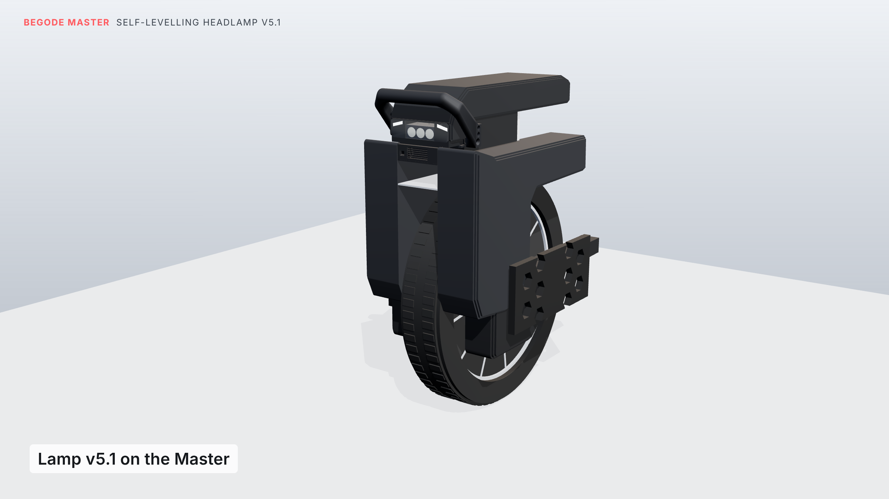

# Begode Master: front handle and self-levelling headlamp

3D-printable parts for the Begode Master electric unicycle:

- **Front handle:** built on the community handle (`reference/euc_master_front_handle.stl`), with every
  original bolt hole kept where it was.
- **Self-levelling headlamp:** fills the stock lamp's opening in the top cover. It has:
  - three LEDs with optics on one heat-sink bar that a servo tilts ±10°, so the beam stays put while the
    wheel pitches (about 1200 lm)
  - a road sensor that follows the slope ahead
  - daytime running lights and day/night switching
  - a phone settings page
  - beam brightness that follows the wheel's lamp voltage (6.5 V dim, 12 V full)
  - a flush clear window and angled running-light lines that follow the Master's faceted front
  - drop-safe: whichever way the wheel falls, the handle, shells or tyre touch the ground first (lamp at least
    20 mm clear)



## What to print now

Everything is in [`current/`](current). [`current/BUILD_GUIDE.md`](current/BUILD_GUIDE.md) has (Estonian: [`BUILD_GUIDE_et.md`](current/BUILD_GUIDE_et.md), [`PARTS_et.md`](current/PARTS_et.md)):

- the parts list
- which LEDs, optics, heat sink and electronics to buy, and the wiring
  (prices and shops in [`current/PARTS.md`](current/PARTS.md), about €80–120)
- hardware and assembly order
- the firmware
- everything that was checked

| Folder | Contents |
|---|---|
| `current/stl/` | handle v12, the original top cap, lamp housing, top plate, head, lid, running-light diffusers, and the window's cutting template (SVG) |
| `current/firmware/headlamp5_firmware/` | ESP32-C3 firmware (Arduino; needs the Pololu "VL53L1X" library) |
| `current/renders/` | stills: day, night, face on, fallen forward / onto its side, and how the head is fitted |
| `reference/` | the original handle and cap STLs, the measurement sheets, and [`MEASUREMENTS.md`](reference/MEASUREMENTS.md) (every measurement taken on the wheel) |
| `source/` | the Python scripts that build, check, export and render every version (see [`source/README.md`](source/README.md)) |
| `archive/` | all earlier versions: guides, STLs, firmware, renders, including v8 with the swing-up can holder and its animation |

**Only `current/` fits the real wheel.** Handles v4 to v9 were drawn on a wheel model traced from photos.
They run into the shells and the top cover, so don't print them. From v10 on, everything is checked
against a model built from caliper measurements.

## Version history

| Guide | Handle | What changed |
|---|---|---|
| — | v1 | cup ring that folds up beside the handle |
| — | v2 | cup ring on hinges at the handle's front corners |
| — | v3–v5 | motorcycle-style folding cup holder; holder for the stock lamp (estimated) |
| headlamp v1 | v5 | self-levelling servo head (ESP32-C3 + MPU-6050) |
| headlamp v2 | v5 | road sensor (VL53L1X), daytime running lights, light sensor, Wi-Fi settings |
| headlamp v3 | v6 | follows the wheel's 6.5 / 12 V lamp output; lamp and cup holder as one unit |
| v4 | v7 | minimal ring that folds under the lamp, with a fold-flat foot |
| v5 | v8 | slide-out self-levelling cup holder (forward/back) |
| v6 | v9 | two-axis gimbal (forward/back and side to side) |
| v7 | v10 | rebuilt to caliper measurements; lamp in front of the cover; can holder swings up into the bay |
| v8 | v11 | lamp built into the stock lamp opening; extra mounting through the cover's two M4 screws |
| lamp v5 | v12 | no can holder; three LEDs on one tilting bar (~1200 lm); electronics box between the shells |
| lamp v5.1 | v12 | flush polycarbonate window, angled running-light lines, chin vent and baffle, checked for drops |
| **lamp v5.2** | **v12** | **open-top housing with a screwed-on top plate, so the head and servo can actually be fitted** |

## Rebuilding

Python 3 with `numpy`, `trimesh`, `manifold3d` and `matplotlib`. Run from `source/`:

```
cd source && mkdir -p ../build_output
python3 check19.py     # every fit / clearance / assembly / drop check for the current version
python3 export19.py    # writes the current STLs and the window SVG to build_output/
```

Stills (three.js in headless Chromium, as for the animation):

```
python3 stills_export.py               # writes anim/stills_data.js
cd anim && npm install
python3 -m http.server 8766 --bind 127.0.0.1 &
node stills_render.mjs                 # anim/stills/f0000.png …
```

To re-render the v8 animation, see `source/README.md`.

Coordinates throughout are the handle STL's own frame: −X forward, +Y up, Z across the wheel (centre Z = −70.5).
