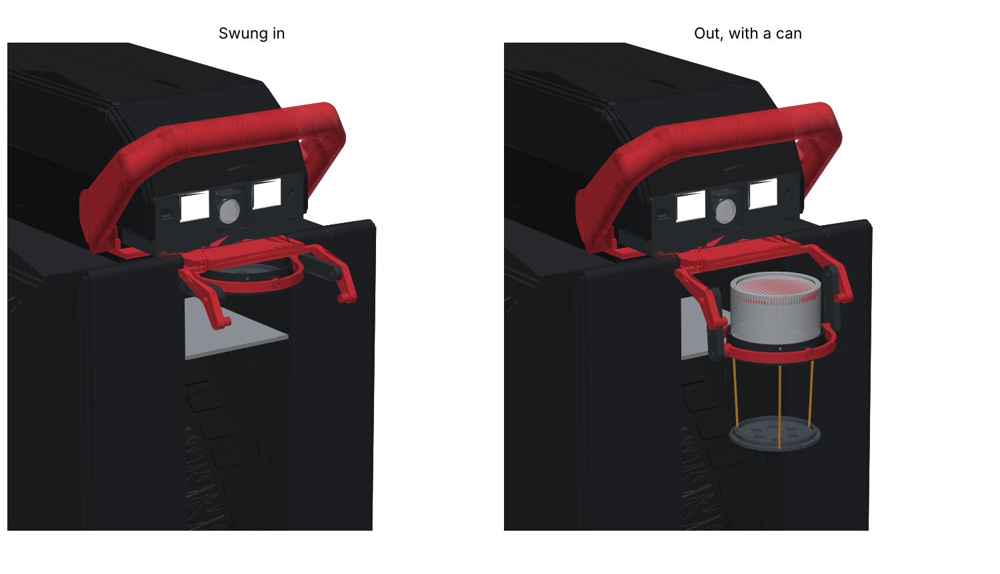

# Begode Master: front handle, self-levelling headlamp and can holder

3D-printable parts for the Begode Master electric unicycle:

- **Front handle:** built on the community handle (`reference/euc_master_front_handle.stl`), with every
  original bolt hole kept where it was.
- **Self-levelling headlamp:** fills the stock lamp's opening in the top cover. It has:
  - a servo-tilted head that holds the beam steady while the wheel pitches
  - a road sensor that follows the slope ahead
  - daytime running lights and day/night switching
  - a phone settings page
  - beam brightness that follows the wheel's lamp voltage (6.5 V dim, 12 V full)
- **Can holder:** swings up under the lamp, levels itself forward/back and side to side in a gimbal, and
  takes a 0.33 l can.



Animation (26 s): [`current/renders/begode_master_v8_animation.mp4`](current/renders/begode_master_v8_animation.mp4)
(720p version next to it).

## What to print now

Everything is in [`current/`](current). [`current/BUILD_GUIDE.md`](current/BUILD_GUIDE.md) has:

- the parts list
- which LED, optic and heat sink to buy
- hardware and assembly order
- the firmware
- everything that was checked

| Folder | Contents |
|---|---|
| `current/stl/` | handle v11, the original top cap, lamp housing, head, tray and diffusers, can holder ring, floor, gimbal ring and swing arms |
| `current/firmware/headlamp4_firmware/` | ESP32-C3 firmware (Arduino; needs the Pololu "VL53L1X" library) |
| `current/renders/` | stills and the animation |
| `reference/` | the original handle and cap STLs, the measurement sheets, and [`MEASUREMENTS.md`](reference/MEASUREMENTS.md) (every measurement taken on the wheel) |
| `source/` | the Python scripts that build, check, export and render every version (see [`source/README.md`](source/README.md)) |
| `archive/` | all earlier versions: guides, STLs, firmware, renders |

**Only `current/` fits the real wheel.** Handles v4 to v9 were drawn on a wheel model traced from photos.
They run into the shells and the top cover, so don't print them. From v10 on, everything is checked
against a model built from caliper measurements.

## Version history

| Guide | Handle | What changed |
|---|---|---|
| — | v1 | cup ring that folds up beside the handle |
| — | v2 | cup ring on hinges at the handle's front corners |
| — | v3–v5 | motorcycle-style folding cup holder; holder for the stock lamp (estimated) |
| headlamp v1 | v5 | self-levelling servo head (ESP32-C3 + MPU-6050) |
| headlamp v2 | v5 | road sensor (VL53L1X), daytime running lights, light sensor, Wi-Fi settings |
| headlamp v3 | v6 | follows the wheel's 6.5 / 12 V lamp output; lamp and cup holder as one unit |
| v4 | v7 | minimal ring that folds under the lamp, with a fold-flat foot |
| v5 | v8 | slide-out self-levelling cup holder (forward/back) |
| v6 | v9 | two-axis gimbal (forward/back and side to side) |
| v7 | v10 | rebuilt to caliper measurements; lamp in front of the cover; can holder swings up into the bay |
| **v8** | **v11** | **lamp built into the stock lamp opening; extra mounting through the cover's two M4 screws** |

## Rebuilding

Python 3 with `numpy`, `trimesh`, `manifold3d` and `matplotlib`. Run from `source/`:

```
cd source && mkdir -p ../build_output
python3 check16.py     # every fit / clearance check for the current version
python3 export16.py    # writes the current STLs to build_output/
python3 render_v8.py   # stills
```

To re-render the animation, see `source/README.md`.

Coordinates throughout are the handle STL's own frame: −X forward, +Y up, Z across the wheel (centre Z = −70.5).
