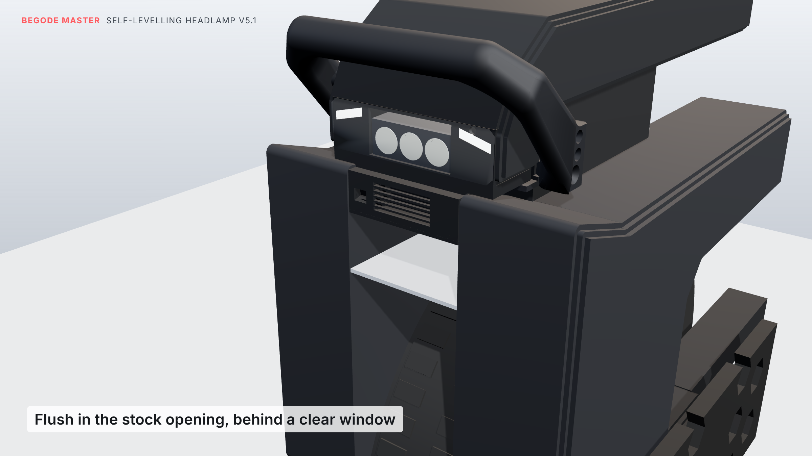
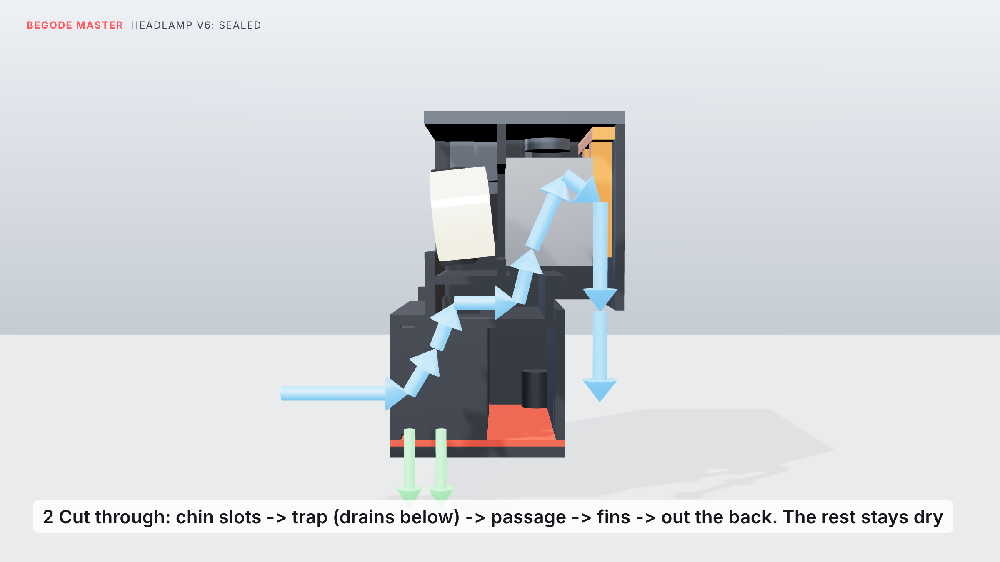

# Lamp v6: sealed, self-levelling three-LED headlamp in the stock lamp opening

The stock lamp comes out, and this lamp sits flush in its opening in the top cover.

- **Sealed against rain, tyre spray and sand (v6):** the tyre sits a few centimetres under the lamp and throws
  water and sand up at it even when the road is only wet. Everything that minds water is sealed:
  - the lenses and the inside of the window
  - the servo and the bearing
  - the electronics and the road sensor

  The cooling air runs through a duct of its own, and the water and sand it carries drain out.
- **The light:** three LEDs with optics in a row: one narrow optic for reach, two wide ones for spread. About
  **1000–1100 lm** (see the note on the lens gap below).
- **Levelling:** the LEDs stay fixed on their heat sink. A light frame holding only the three lenses tilts ±10°
  about the line through the three LED chips, so the beam stays steady when the wheel pitches (braking,
  accelerating, bumps, hills). A road sensor, a gyro, daytime running lights and day/night switching are all
  built in.
- **No phone needed:** two buttons in the chin set the aim, brightness, mode, calibration and the USB charger.
  The Wi-Fi settings page stays off unless you ask for it.
- **USB-C charger:** a sealed USB-C port in the handle charges a phone from the wheel. A power guard keeps the
  lamp and charger together inside the wheel's lamp output; the beam always comes first.
- **Built for drops:**
  - whichever way the wheel falls, the handle grip, the shells or the tyre hit the ground first, and the lamp
    stays at least 19.7 mm clear;
  - inside, hard stops catch the lens frame at ±12°;
  - the moving part now weighs about 15 g instead of 70 g, so a drop hardly loads the servo at all.
- **Looks:** a clear 1.5 mm polycarbonate window sits flush in the opening, 0.7 mm behind the cover's front
  edge, over a black face. The running lights are two angled light lines that follow the Master's faceted shape.



Everything is checked against the model of your wheel built from your caliper measurements
(`../reference/MEASUREMENTS.md`). Prices and shops: [`PARTS.md`](PARTS.md). Test plan and log:
[`TESTING.md`](TESTING.md).

## How it's built



- **LEDs, fixed:** the three stars sit on the finned aluminium bar, which is clamped behind a wall (the
  bulkhead) inside the lamp. The LEDs look forward through a window in that wall. Their side is dry; the fins
  behind are in the cooling duct. A bead of silicone seals the bar's face to the wall.
- **Lenses, tilting:** the three lenses sit in a printed frame. It turns on a sealed 6800-2RS ball bearing on the
  left and on the servo's shaft on the right. The pivot runs through the LED chips, so turning the lenses turns
  the beam with them.
- **The lens gap:** the lenses stand 2 mm off the LED boards so they can swing without touching. Some light
  escapes through that gap. By my estimate, 10–15 % (so about 1000–1100 lm instead of 1200); the bench test
  in [`TESTING.md`](TESTING.md) measures the real figure.
- **Hard stops:** a lug on the frame meets stops at ±12°; the firmware keeps the lenses within ±10°.
- **Control:** about 200 times a second, the ESP32 reads the gyro (MPU-6050) and works out how far the wheel is
  pitched. The road sensor (VL53L1X) measures the slope ahead. The servo turns the lenses the other way, so the
  beam stays at the aim you set (default 2° below the road).

### Where the air, water and sand go

1. **In:** through the slots in the chin, either side of the buttons.
2. **Trap:** into a chamber behind the chin. Water and sand drop to the bottom and run out through the drain
   slots in the lid; the air turns upward.
3. **Passage:** back through a passage under the lenses (walled off from them).
4. **Fins:** up through the floor into the heat sink's fins.
5. **Out:** down the back of the lamp into the space between the shells.

The dry spaces are sealed by:
- **the inside of the window and the lenses:** the window's foam tape, the bulkhead and the bar's silicone
  seal;
- **the side bays (servo, bearing, drivers):** the inner walls;
- **the electronics box:** the gasketed lid;
- **the road-sensor pocket:** its own small window;
- **the buttons:** a closed box behind the chin.

The wires pass between dry spaces only: from the LEDs through the left pivot pocket, and from the road sensor
through a hole into the box.


## The buttons

Two buttons sit one above the other in the middle of the chin, so either hand reaches them: **+** on top,
**−** below. They sit in pockets below the surface, so a knock or a drop can't press them. The lamp also
ignores any press shorter than 0.4 s, and any press while the wheel moves or lies on its side.

| Press | Does |
|---|---|
| **+** tap | aim 0.5° higher; the beam moves as you press |
| **−** tap | aim 0.5° lower |
| **+** hold 3 s | brightness 50 → 70 → 85 → 100 % (1–4 blinks) |
| **−** hold 3 s | mode: auto → beam on → running lights only (1 / 2 / 3 blinks) |
| both, tap | USB charger off / on (1 / 2 blinks) |
| both, hold 3 s | calibrate: wheel upright on flat ground (3 blinks) |
| both, hold 6 s | Wi-Fi settings page on for 10 minutes (4 blinks) |
| both, hold 10 s | back to factory settings |

The blinks are the running lights. While you hold, they flash once at 3, 6 and 10 s, so you know when to let go.

## The USB charger

A sealed USB-C socket (IP67, with a cap) sits in the outer face of the handle's right leg, near the top. Its two
wires run inside the leg, along a groove in the web, and up through a hole in the housing's side floor, with a
grommet. Use `master_handle_v13_usb_left.stl` instead if you want it on the left.

- **Power:** it gives 5 V at up to 1.5 A, about 7.5 W.
- **Sharing with the lamp:** an INA219 measures what the whole lamp draws. When lamp and charger go over the
  limit (20 W by default), the beam is turned down. If the beam would drop below 70 % at night, the charger
  pauses for a minute instead. By day the beam is off, so the charger has the room to itself.
- **Turning it off:** tap both buttons.

## Bought parts

| Part | Qty | Notes |
|---|---|---|
| Luminus SST-20 (or Cree XM-L2 / XP-L), 3 V, on a **16 mm** copper star | 3 | 4000–5000 K |
| 20 mm TIR optic for a 16 mm star | 3 | 1 × 10° round (centre, reach), 2 × **elliptical** wide (sides) |
| Finned aluminium heat-sink bar | 1 | flat face 25 mm tall, fins no deeper than 20 mm, fins running front to back. **Cut to 62 mm wide** |
| Clear polycarbonate sheet, 1.5 mm (and 1 mm, or the same 1.5 mm) | 1 | the window (`stl/lamp60_window_1.5mm_polycarbonate.svg`) and the road sensor's small window (13.4 × 13.8 mm) |
| Thin double-sided foam tape, 0.5 mm, 3–5 mm wide | | the window, and a strip on the inner walls' top edges under the top plate |
| Neutral-cure clear silicone | | seals the LED bar's face to the bulkhead; glues the sensor window |
| Mean Well LDD-1500L (or LDD-1000L / PT4115, see `PARTS.md`) | 3 | one per LED |
| ESP32-C3 SuperMini | 1 | |
| MPU-6050 (GY-521) | 1 | |
| VL53L1X module (13 × 18 mm) | 1 | road sensor |
| INA219 module (0.1 Ω shunt) | 1 | power guard |
| MG90S metal-gear servo | 1 | |
| 6800-2RS ball bearing (10 × 19 × 5 mm, sealed) | 1 | the lens frame's pivot |
| MP1584EN buck module | 2 | one at 5.0 V (electronics), one at 5.1 V (USB) |
| Logic-level MOSFET module (D4184 / AO3400) | 2 | running lights; USB charger switch |
| 8 mm sealed momentary push button (IP67, flat head) | 2 | the chin buttons |
| USB-C panel socket, IP67 with cap, 16 mm hole, CC1/CC2 brought out | 1 | the handle port |
| 22 kΩ resistors | 2 | CC1 and CC2 to VBUS at the socket |
| 5 V white LED strip, 2835, 120/m | about 14 LEDs | daytime running lights |
| GL5528 LDR + 10 k; 10 k NTC (B3950) + 10 k | | light sensor, heat-sink temperature |
| Plug that matches the wheel's lamp plug (stock: yellow JST-XH, 2 pin) | 1 | |
| Rubber grommets for a 6 mm hole | 2 | the wheel's power cable (back wall), the USB wire (side floor) |
| Conformal coating spray (acrylic or silicone) | | a thin coat on every circuit board |
| 26 AWG silicone wire; 2-core 24 AWG silicone wire, about 40 cm | | |
| 2-part epoxy | | the USB socket in the handle |

## Printed parts

| File | Qty | How |
|---|---|---|
| `stl/master_handle_v13_usb_right.stl` (or `_left`) | 1 | PETG/ASA. On its side, supports under the grip |
| `stl/master_handle_top_cap_p2.stl` | 1 | your original cap |
| `stl/lamp60_housing.stl` | 1 | black ASA, 4 walls, open top on the bed, as exported. "Fuzzy skin" on for the shells' grainy look |
| `stl/lamp60_top_plate.stl` | 1 | ASA/PETG, top face on the bed, tongues up |
| `stl/lamp60_lens_frame.stl` | 1 | PETG/ASA, front on the bed |
| `stl/lamp60_bar_clamp.stl` | 1 | PETG/ASA, flat |
| `stl/lamp60_lid.stl` | 1 | ASA/PETG, flat |
| `stl/lamp60_gasket_TPU.stl` | 1 | **TPU 95A**, flat, 100 % infill |
| `stl/lamp60_drl_diffuser_left.stl`, `_right.stl` | 1 each | white or clear PETG, 100 % infill |

## Hardware

- **Lamp to cover:** the stock lamp's 2 M4 screws, into 2 **M4 heat-set inserts** (5.7 mm long, 5.6 mm OD) in the
  top plate's bosses.
- **Top plate to housing:** 4 × M3 × 8 countersunk.
- **Bar clamp:** 2 × M3 × 10 self-tapping into its posts.
- **Lamp to handle:** 2 × M3 × 10 self-tapping, up through the handle's webs into the housing.
- **Lid:** 4 × M3 × 10 self-tapping (through the lid and the gasket).
- **Servo horn:** the 2 small screws that come with it. The servo itself needs no screws.
- **Buttons:** their own nuts.

## Wiring

```
wheel lamp plug + ── INA219 VIN+      INA219 VIN- ──┬── LDD-1500L #1, #2, #3  VIN+
                                                    ├── MP1584 #1 IN+   (electronics, 5.0 V)
                                                    └── MP1584 #2 IN+   (USB, 5.1 V)
wheel lamp plug - ──── common ground
MP1584 #2 IN- ── MOSFET module #2, load - side      (its supply - to ground, its control to GPIO0)
MP1584 #2 OUT+ / OUT- ── 2-core wire through the handle ── USB-C socket VBUS / GND
                         at the socket: 22 k from CC1 to VBUS, 22 k from CC2 to VBUS
LDD #n  LED+ / LED- ── LED #n            (each LED on its own driver; don't join the LED- wires)
LDD DIM #1 + #2 + #3 ── GPIO5            (all three together)
MP1584 #1 OUT 5.0 V ──┬── ESP32-C3 5V, servo red, MOSFET module #1 DC+ (→ both DRL strips)
ESP32 3V3 ──┬── MPU-6050 VCC, VL53L1X VIN, INA219 VCC
            ├── 10 k ── GPIO3 ── NTC ── GND (NTC glued to the bar's face, above the middle LED)
            └── LDR ── GPIO1 ── 10 k ── GND
GPIO6 SDA / GPIO7 SCL ── MPU-6050, VL53L1X and INA219     GPIO10 ── servo     GPIO4 ── MOSFET module #1
button + ── GPIO20 and GND               button - ── GPIO21 and GND
```

Keep the USB side's ground (MP1584 #2 OUT−, the socket's GND) away from the common ground. The MOSFET module
switches the charger by cutting its ground.

## Assembly

1. **LED bar:**
   - Cut the heat sink to 62 mm wide.
   - Glue the three stars to its face with thermal adhesive: centred top to bottom, 21 mm apart, the middle
     one in the middle.
   - Glue the NTC to the face above the middle star.
   - Solder the wires.
2. **Housing, open top up:**
   - Glue the two diffusers into their recesses, with LED strip rows behind them.
   - Push the LDR into its hole near the top of the face.
   - Fit the two chin buttons, + on top, from the front. Do their nuts up from inside the button box: reach in
     through the electronics box (lid off) and the opening in the divider.
   - Glue the small polycarbonate window into its recess over the road sensor's tunnel with silicone, and slide
     the sensor board into its slot from below.
   - Push the grommet into the power-cable hole in the back wall.
3. **LED bar in:**
   - Run a thin bead of silicone round the edge of the bar's face.
   - Feed the LED and NTC wires forward through the bulkhead's window.
   - Lower the bar in behind the bulkhead, push it forward so the stars sit in the window, and fit the clamp
     (2 × M3).
   - Lead the wires along the bulkhead's front to the hole in the left pivot pocket, into the left side bay.
4. **Lens frame and servo, on the bench:**
   - Push the three lenses into the frame from behind (a drop of glue holds them).
   - Press the 6800-2RS onto the pin until it sits against the shoulder.
   - Set the servo to the middle of its travel. Screw the horn into the recess on the frame's right hub (its
     arm points up), and press the servo's shaft into the horn with the frame level.
5. **Lens frame in:** lower the frame and servo in together: the bearing into its seat in the left wall, the
   servo's shaft into the slot in the right wall, its tabs into the slots in its posts. Nothing needs forcing.
   Tilt the frame by hand: it should swing freely and stop softly on the stops.
6. **Top plate:**
   - Lay foam tape along the top edges of the bulkhead and the short walls beside the pivot pockets. These are
     the edges where dry meets wet.
   - Melt the M4 inserts into the plate's bosses, set it on, and fix it with 4 × M3 × 8 countersunk.
7. **Electronics:**
   - Give every board a thin coat of conformal coating first. Keep it off connectors, the sensors' windows and
     the LDR.
   - **Left side bay:** the three LED drivers and buck #1.
   - **Right side bay:** behind the servo, buck #2, both MOSFET modules and the INA219.
   - **Electronics box:** the ESP32 and the MPU-6050 (flat, X arrow forward).
   - Fix everything with foam tape.
8. **USB in the handle:** as before: wire through the handle's channel, solder the socket with its two 22 k
   resistors, epoxy it into the leg, cap on.
9. **Window:** foam tape round the edge of the face, press the polycarbonate window on, film off last.
10. **Into the wheel:** push the lamp up into the opening, screw the cover's two M4 screws into the inserts.
11. **Handle:**
    - Feed the USB wire up through the side-floor hole (grommet).
    - Bolt the handle on, and fit the two M3 screws up through its webs into the lamp.
    - Connect the USB wire to buck #2.
12. **Lid:** the TPU gasket, then the lid, 4 × M3 × 10. The drain slots go under the trap, at the front.
13. **Firmware:**
    - Flash `firmware/headlamp6_firmware/headlamp6_firmware.ino` (Arduino IDE, board *ESP32C3 Dev Module*, USB
      CDC On Boot: Enabled, Pololu "VL53L1X" library).
    - Stand the wheel upright on flat ground, hold both buttons 3 s to calibrate, then tap + or − to set the aim.

## What I checked (against the measured wheel)

- **Fit:** the housing, top plate, lid, gasket and window stay clear of the shells, the cover, the controller and
  the motor cable. With the suspension bottomed out, the lid stays 3.0 mm above the cross plate.
- **Lenses:** they swing ±12° without touching the housing, the top plate, the window, the LED bar or the servo.
  The lens bases stay 0.65 mm off the LED boards at ±10° and 0.35 mm at ±12°.
- **Stops:** the lug meets the stops at ±12.4°. Pushed to ±13.5°, only the lug and the stops meet.
- **Putting it together:**
  - The lens frame and servo come straight out of the open housing with nothing touching, so they go in the
    same way.
  - The LED bar goes in 2.5 mm behind the bulkhead and slides forward.
  - The top plate lifts straight off.
- **Sealing:** in the model, I filled every space that outside air can reach.
  - It reaches the trap, the passage, the fins and the rear exit.
  - It doesn't reach the inside of the window, the lens bay, the pivot pockets, either side bay, the electronics
    box, the road-sensor pocket or the button box. That counts the window tape, the gasket, the grommets and the
    screws as fitted.
  - The narrowest point of the duct is 355 mm² (trap to passage), about a 21 mm hole.
- **Drops:** I tested about 18,000 fall directions. In every one, the handle grip, the shells or the tyre touch
  the ground first, and the lamp stays at least 19.7 mm clear (25 mm falling straight forward).
- **Road sensor:** its view is clear of everything. It now looks through a small window. Keep the window clean;
  if it's dirty the lamp levels on the gyro alone.
- **Parts:** every part is one solid piece.
- **Firmware:** it compiles against stand-in Arduino headers, and I ran the buttons through a simulation. It
  hasn't run on real hardware yet.

## Worth knowing

- **Rinse the chin now and then.** The trap catches sand on purpose; a quick rinse with the lid on flushes it out
  through the drains.
- **Heat:** the cooling works best when riding (air comes in through the chin). When you stand still with the
  beam on, the heat-sink sensor turns the beam down. That's expected.
- **Road sensor window:** if it gets misted or muddy, the lamp falls back to the gyro alone and still levels;
  wipe it when you clean the wheel.
- **Top cover:** the lamp is screwed to it, like the stock lamp. Take out the two top screws before lifting the
  cover.
