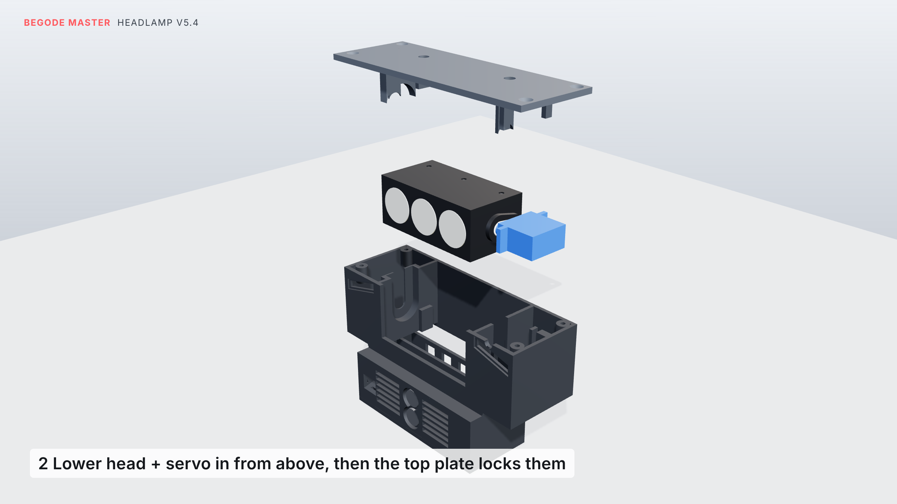
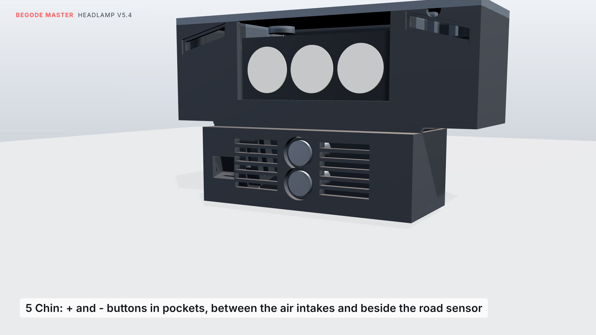
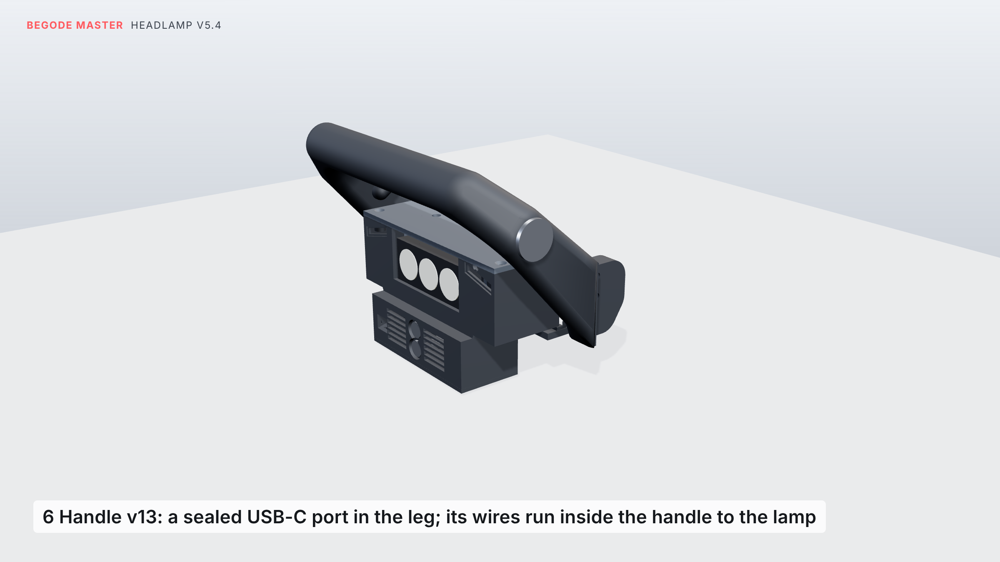

# Lamp v5.4: three-LED self-levelling headlamp in the stock lamp opening

The stock lamp comes out, and this lamp sits flush in its opening in the top cover. There is no cup
holder any more.

- **The light:** three LEDs with optics in a row: one narrow optic for reach, two wide ones for spread.
- **Levelling:** all three sit on one finned heat-sink bar, which a servo tilts ±10° to hold the beam
  steady when the wheel pitches (braking, accelerating, bumps, hills). A road sensor, a gyro, daytime running
  lights and day/night switching are all built in.
- **Brightness:** about **1200 lm** at 85–90 %, about 2.5× the single-LED v4.
- **No phone needed (v5.4):** two buttons in the chin set the aim, brightness, mode, calibration and the USB
  charger. The Wi-Fi settings page still exists, but it stays off unless you ask for it.
- **USB-C charger (v5.4):** a sealed USB-C port in the handle charges a phone from the wheel. A power guard keeps
  the lamp and charger together inside what the wheel's lamp output gives; the beam always comes first.
- **Built for drops (v5.4):** whichever way the wheel falls, the handle grip, the shells or the tyre hit the
  ground first, and the lamp stays at least 20 mm clear. Inside, hard stops catch the head at ±12°, so a
  drop doesn't load the servo's gears.
- **Electronics:** they sit in a box that hangs down into the bay between the shells, with a lid underneath,
  so you can reach them without taking the lamp out.
- **Mounting:** the lamp is held by the cover's two stock M4 screws, and by two webs that run back to the
  handle.
- **Looks:** a clear 1.5 mm polycarbonate window sits flush in the opening, 0.7 mm behind the cover's front
  edge, over a black face. The running lights are two angled light lines that follow the Master's faceted shape.


Everything is checked against the model of your wheel built from your caliper measurements
(`../reference/MEASUREMENTS.md`). Prices and shops: [`PARTS.md`](PARTS.md). Test plan and log for drops and
crashes: [`TESTING.md`](TESTING.md).

## How the levelling works



- **Pivot:** the head (the three LEDs and optics on the finned heat-sink bar) hangs between two inner walls of
  the housing, on one axis across the wheel.
  - On the left, a sealed 6800-2RS ball bearing sits on a hollow pin on the head. The LED and temperature-sensor
    wires come out through the pin, so nothing flexes outside. A printed pin in a printed hole would work at
    first, but it binds if the print is tight, grinds with road dust and wears loose.
  - On the right, the servo's shaft sits on the same axis, and its horn is screwed to the head.
- **Drive:** there are no gears or links: the servo turns the head directly. The firmware keeps it within ±10°.
- **Hard stops:** a lug on the head's left side sits between two stops, one on the housing and one on the top
  plate. They meet at ±12°. When the wheel lands hard, the head's weight wants to keep turning; the stops take
  that instead of the servo's small gears.
- **Control:** about 200 times a second, the ESP32 reads the gyro (MPU-6050) and works out how far the wheel is
  pitched. The road sensor (VL53L1X) measures the slope ahead. The firmware turns the head the other way, so
  the beam stays at the aim you set (default 2° below the road) when you brake, accelerate, hit bumps or ride
  up and down hills. If the wheel falls over, the head simply holds your aim.
- **Load:** the head weighs about 70 g and its centre is close to the axis, so the servo has little work to do.
  An MG90S with metal gears is plenty.
- **Holding it in:** the housing is open on top. Head and servo go in from above as one unit: the bearing drops
  into a seat in the left wall, the servo shaft into a slot in the right wall, the servo's tabs into slots in its
  two posts. The top plate's tongues go down into those slots, so nothing can lift out, and four countersunk
  screws hold the plate. The servo needs no screws of its own.

Renders: `renders/render_v54_mechanism_1.png` … `_7.png` (bench, fitting, servo side, bearing side, chin
buttons, handle USB port, hard stops).

## The buttons



Two buttons sit one above the other in the middle of the chin, so either hand reaches them: **+** on top,
**−** below. They sit in pockets below the surface, so a knock or a drop can't press them. The lamp also
ignores any press shorter than 0.4 s, and any press while the wheel moves or lies on its side.

| Press | Does |
|---|---|
| **+** tap | aim 0.5° higher; the beam moves as you press |
| **−** tap | aim 0.5° lower |
| **+** hold 3 s | brightness 50 → 70 → 85 → 100 % (1–4 blinks) |
| **−** hold 3 s | mode: auto → beam on → running lights only (1 / 2 / 3 blinks) |
| both, tap | USB charger off / on (1 / 2 blinks) |
| both, hold 3 s | calibrate: wheel upright on flat ground (3 blinks) |
| both, hold 6 s | Wi-Fi settings page on for 10 minutes (4 blinks) |
| both, hold 10 s | back to factory settings |

The blinks are the running lights. While you hold, they flash once at 3, 6 and 10 s, so you know when to let go.

## The USB charger



A sealed USB-C socket (IP67, with a cap) sits in the outer face of the handle's right leg, near the top. Its two
wires run down a channel inside the leg, through the handle's lower block, along a groove in the web, and up
into the lamp through a hole in the housing's side floor. They never run outside the wheel. Use
`master_handle_v13_usb_left.stl` instead if you want it on the left.

- **Power:** it gives 5 V at up to 1.5 A, about 7.5 W.
- **Sharing with the lamp:** the wheel's lamp output gives about 20 W in all. An INA219 measures what the
  whole lamp draws.
  - When lamp and charger go over the limit, the beam is turned down.
  - If the beam would drop below 70 % at night, the charger pauses for a minute instead. The beam always comes
    first.
  - By day the beam is off, so the charger has the room to itself.
- **Turning it off:** tap both buttons.
- **Raising the limit:** if your wheel's plug gives more than 20 W (measure it), raise the limit on the Wi-Fi
  page.

## Bought parts

| Part | Qty | Notes |
|---|---|---|
| Luminus SST-20 (or Cree XM-L2 / XP-L), 3 V, on a **16 mm** copper star | 3 | 4000–5000 K |
| 20 mm TIR optic for a 16 mm star | 3 | 1 × 10° round (centre, reach), 2 × **elliptical** wide (sides: a flat, wide band of light) |
| Clear polycarbonate sheet, 1.5 mm | 1 | cut to `stl/lamp54_window_1.5mm_polycarbonate.svg` (133 × 35.8 mm, chamfered corners) |
| Thin double-sided foam tape, 0.5 mm, 3–5 mm wide | | holds the window on the lamp face and seals it |
| Finned aluminium heat-sink bar | 1 | flat face **64 × 25 mm**, no deeper than 20 mm, fins running front to back. Cut it from an extruded profile |
| Mean Well LDD-1500L | 3 | one per LED; works from the wheel's 6.5 V dim mode |
| ESP32-C3 SuperMini | 1 | |
| MPU-6050 (GY-521) | 1 | |
| VL53L1X module (13 × 18 mm) | 1 | road sensor |
| INA219 module (0.1 Ω shunt) | 1 | measures what the lamp draws from the wheel (power guard) |
| MG90S metal-gear servo | 1 | |
| 6800-2RS ball bearing (10 × 19 × 5 mm, sealed) | 1 | for the head's pivot pin |
| MP1584EN buck module | 2 | one set to 5.0 V (electronics), one to 5.1 V (USB) |
| Logic-level MOSFET module (D4184 / AO3400) | 2 | one for the running lights, one switches the USB charger |
| 8 mm sealed momentary push button (IP67, flat head) | 2 | the chin buttons |
| USB-C panel socket, IP67 with cap, **16 mm** panel hole, with CC1/CC2 brought out | 1 | the handle port |
| 22 kΩ resistors | 2 | CC1 and CC2 to VBUS at the socket: tells the phone it may draw 1.5 A |
| 5 V white LED strip, 2835, 120/m | about 14 LEDs | daytime running lights |
| GL5528 LDR + 10 k; 10 k NTC (B3950) + 10 k | | light sensor, heat-sink temperature |
| Plug that matches the wheel's lamp plug (stock: yellow JST-XH, 2 pin) | 1 | |
| 26 AWG silicone wire | | the 8 wires through the hollow pivot pin, buttons, sensors |
| 2-core 24 AWG silicone wire, about 40 cm | 1 | USB socket to the lamp, through the handle |
| 2-part epoxy | | glues the USB socket into the handle and seals it |

## Printed parts (PETG or ASA, 4 walls)

| File | Qty | How |
|---|---|---|
| `stl/master_handle_v13_usb_right.stl` (or `_left`) | 1 | your handle with the webs, the USB port and its wire channel. On its side, supports under the grip |
| `stl/master_handle_top_cap_p2.stl` | 1 | your original cap |
| `stl/lamp54_housing.stl` | 1 | open top on the bed, as exported. Black ASA, "fuzzy skin" on in the slicer for the shells' grainy look |
| `stl/lamp54_top_plate.stl` | 1 | top face on the bed, tongues up, as exported |
| `stl/lamp54_head.stl` | 1 | open back on the bed, as exported |
| `stl/lamp54_lid.stl` | 1 | outside face on the bed, as exported |
| `stl/lamp54_drl_diffuser_left.stl`, `stl/lamp54_drl_diffuser_right.stl` | 1 each | white or clear PETG, 100 % infill (the angled light lines) |

## Hardware

- **Lamp to cover:** the stock lamp's 2 M4 screws, into 2 **M4 heat-set inserts** (5.7 mm long, 5.6 mm OD).
  Melt the inserts into the two bosses under the top plate.
- **Top plate to housing:** 4 × M3 × 10 countersunk (self-tapping, or plain machine screws that cut their own
  thread). Their heads sit flush, under the cover.
- **Lamp to handle:** 2 × M3 × 10 self-tapping, up through the handle's webs into the housing.
- **Lid:** 4 × M3 × 8 self-tapping.
- **Inside the lamp:**
  - 3 × M3 × 8 self-tapping (heat-sink fins)
  - 2 small screws that come with the servo horn (horn to head)
  - the servo itself needs no screws: its tabs sit in slots, and the top plate holds them down
- **Buttons:** their own nuts, from inside the chin.

## Wiring

```
wheel lamp plug + ── INA219 VIN+      INA219 VIN- ──┬── LDD-1500L #1, #2, #3  VIN+
                                                    ├── MP1584 #1 IN+   (electronics, 5.0 V)
                                                    └── MP1584 #2 IN+   (USB, 5.1 V)
wheel lamp plug - ──── common ground
MP1584 #2 IN- ── MOSFET module #2, load - side      (its supply - to ground, its control to GPIO0)
MP1584 #2 OUT+ / OUT- ── 2-core wire through the handle ── USB-C socket VBUS / GND
                         at the socket: 22 k from CC1 to VBUS, 22 k from CC2 to VBUS
LDD #n  LED+ / LED- ── LED #n            (each LED on its own driver; don't join the LED- wires)
LDD DIM #1 + #2 + #3 ── GPIO5            (all three together)
MP1584 #1 OUT 5.0 V ──┬── ESP32-C3 5V, servo red, MOSFET module #1 DC+ (→ both DRL strips)
ESP32 3V3 ──┬── MPU-6050 VCC, VL53L1X VIN, INA219 VCC
            ├── 10 k ── GPIO3 ── NTC ── GND (NTC glued to the heat-sink bar)
            └── LDR ── GPIO1 ── 10 k ── GND
GPIO6 SDA / GPIO7 SCL ── MPU-6050, VL53L1X and INA219     GPIO10 ── servo     GPIO4 ── MOSFET module #1
button + ── GPIO20 and GND               button - ── GPIO21 and GND
```

Keep the USB side's ground (MP1584 #2 OUT−, the socket's GND) away from the common ground. The MOSFET module
switches the charger by cutting its ground, which only works if nothing else joins it.

**Power:** the three LEDs at 90 % draw about 13 W, the running lights about 3 W by day, and the rest about 1 W.
The charger adds up to about 8 W. The power guard keeps the total at the limit (20 W by default) by turning the
beam down, or by pausing the charger at night.

## Assembly

1. **Head:**
   - Glue the three stars to the heat-sink bar with thermal adhesive. The narrow optic goes in the middle, in
     line with the head's three apertures.
   - Glue the NTC to the bar.
   - Slide the bar into the head from the back and fix it with the three M3 screws into the fins.
2. **Head and servo, on the bench:**
   - Thread the 8 wires (6 LED, 2 temperature sensor) out through the hollow pin, then press the 6800-2RS onto
     the pin until it sits against the shoulder. It should be a firm push fit. If it's too tight, sand the
     pin lightly; if it's loose, use a drop of superglue on the pin (keep it off the seals).
   - Set the servo to the middle of its travel: use a servo tester's centre position, or turn the shaft gently
     by hand halfway between its two ends.
   - Screw the single-arm horn into the recess on the head's right boss.
   - With the head level and the servo lying flat along it (tabs level), press the servo's shaft into the horn.
     Leave out the horn's centre screw: you can't reach it, and the housing stops the two from parting.
3. **Housing,** open top up:
   - Glue the two angled diffusers into their recesses, with LED strip rows behind them.
   - Push the LDR into its hole near the top of the face. It looks out through the window.
   - Fit the two chin buttons, + on top, from the front, with their nuts inside. Their heads sit in the pockets,
     below the surface.
   - Lower the head and servo in together: the bearing into its seat in the left wall, the servo's shaft into the
     slot in the right wall, its two tabs into the slots in its posts. Nothing needs forcing. The lug on the
     head's left side drops in above the lower stop.
   - Lead the 8 wires from the end of the pin, and the servo cable, down into the electronics box.
   - **Top plate:** melt the two M4 inserts into its bosses, then set it on. Its tongues go down into the four
     slots, the one on the left holds the bearing down, and its finger becomes the upper stop. Fix it with the
     4 countersunk M3 screws.
   - Tilt the head by hand: it should swing freely a little past level each way and stop softly on the stops.
4. **Electronics box:** put the three LDD-1500L, the ESP32, the MPU-6050 (flat, X arrow forward), the INA219,
   both bucks and both MOSFET modules on foam tape in the box under the head. Keep clear of the button bodies
   behind the chin. Slide the road sensor board into its slot behind the little tunnel beside the chin vent.
   Don't put glass or film in front of it; it stays outside the window.
5. **USB in the handle:**
   - Push a stiff wire through the handle's channel, from the socket hole down to the lower block, and pull the
     2-core wire back through with it.
   - Solder it to the socket's VBUS and GND, with the two 22 k resistors from CC1 and CC2 to VBUS. Sleeve
     everything with heat-shrink.
   - Glue the socket into its hole with epoxy under the flange. The socket's nut doesn't fit inside the leg, and
     the epoxy also seals it. Fit the cap.
   - The wire comes out of the lower block's inner face. Lay it in the web's groove.
6. **Window:** run the foam tape round the edge of the lamp's face and press the polycarbonate window onto it.
   Peel the protective film off last.
7. **Into the wheel:** push the lamp up into the opening from below, then screw the cover's two M4 screws
   down into the inserts.
8. **Handle:** feed the USB wire up through the hole in the housing's side floor, at the back corner on the
   handle's side, then into the electronics box. Bolt the handle on as usual, and fit the two M3 screws up
   through its webs into the lamp. Connect the wire to MP1584 #2.
9. **Lid:** close it with 4 × M3. Take it off any time to reach the electronics.
10. **Firmware:**
    - Flash `firmware/headlamp6_firmware/headlamp6_firmware.ino` (Arduino IDE, board *ESP32C3 Dev Module*,
      USB CDC On Boot: Enabled, Pololu "VL53L1X" library).
    - Stand the wheel upright on flat ground and hold both buttons for 3 s: the running lights blink three
      times and the lamp is calibrated.
    - Tap + or − to set the aim (default 2° below the road).

## What I checked (against the measured wheel)

- **Fit:** the housing and lid stay clear of the shells, the cover, the controller and the motor cable.
- **Suspension:** with the suspension bottomed out, the lid stays 4.5 mm above the cross plate.
- **Head:** it tilts ±10° without touching the housing, the servo or the window (4–5 mm spare at the top, 6 mm
  below). It's still clear at ±11.5°.
- **Stops:** the head's lug meets the stops at ±12°. Pushed to ±13°, only the lug and the stops meet: nothing
  else of the head touches anything.
- **Putting it together:** the head and servo come straight out of the open housing with nothing touching on
  the way, so they go in the same way. With the top plate on, neither the bearing nor the servo can move.
- **Bearing:** it fits its seat and the pin. The pin is a closed tube, and the lip beside the bearing only
  touches its outer ring.
- **Buttons:** they sit 1 mm below the chin's surface, clear of the box, the lid and the wheel.
- **USB:**
  - The socket fits its hole and the space behind the leg, clear of the wheel.
  - The wire channel stays inside the leg, with walls of 1.2 mm or more.
  - The groove stays inside the web, and handle v13 doesn't touch the wheel or the lamp.
- **Window:** it fits inside the opening and sits 0.7 mm behind the cover's front edge.
- **Drops:** I tested about 18,000 fall directions. In every one, the handle grip, the shells or the tyre touch
  the ground first, and the lamp stays at least 19.8 mm clear: 25 mm falling straight forward, 48 mm onto a
  front corner, 91 mm onto a side. The lenses stay above the cover's front lip the whole way: at the lowest
  they're still 2.3 mm above it.
- **Road sensor:** its view is clear of everything. It looks at the road about 2.2 m ahead.
- **Parts:** every part is one solid piece.
- **Firmware:**
  - It compiles against stand-in Arduino headers.
  - I ran the button logic in a simulation: taps, holds and combinations do what the table says, and presses
    that are too short or made while the wheel moves do nothing.
  - It hasn't run on real hardware yet.

## Worth knowing

- **Heat:** the window seals the front, so air comes in through the chin vent either side of the buttons. It
  rises under the front half of the head, passes the heat sink, and drops behind a baffle to the slots in the
  back of the electronics box. Keep the vents clear of mud. When you stand still with the beam on, the
  heat-sink sensor turns the beam down. That's expected.
- **Aim:** set it with the buttons. There's no screw adjustment; the head does it.
- **Top cover:** the lamp is screwed to it, like the stock lamp. Take out the two top screws before lifting
  the cover.
- **Measure the plug once** before first use, light on (expect about 6.5 V dim and 12 V full, and about 20 W).
  The INA219 shows the voltage and power on the Wi-Fi page, if you want to check it.
