# Lamp v6.4: sealed, self-levelling three-LED headlamp in the stock lamp opening

The stock lamp comes out, and this lamp sits flush in its opening in the top cover.

- **Sealed against rain, tyre spray and sand (v6):** the tyre sits a few centimetres under the lamp and throws
  water and sand up at it even when the road is only wet. Everything that minds water is sealed:
  - the lenses and the inside of the window
  - the servo and the bearing
  - the electronics

  The cooling air runs through a duct of its own, and the water and sand it carries drain out.
- **The light:** three LEDs with optics in a row: one narrow optic for reach, two wide ones for spread. About
  **1000–1100 lm** (see the note on the lens gap below).
- **Levelling:** the LEDs stay fixed on their heat sink. A light frame holding only the three lenses tilts ±10°
  about the line through the three LED chips, so the beam stays steady when the wheel pitches (braking,
  accelerating, bumps). A road sensor makes it follow hills (v6.4). A gyro, daytime running lights and day/night
  switching are built in.
- **Sees hills, and dips for others (v6.4):**
  - An EUC balances to gravity, not to the road. On a steady hill the shell stays level and the gyro sees
    nothing, so v6.1–v6.3 could not really follow hills (their "follow hills" only followed your pedal angle).
    A small laser distance sensor now looks at the road just ahead, through the main window, and the beam
    tips with the slope you are on.
  - Two buttons on the handle's leg, next to the USB port, dip the beam for oncoming traffic, raise it to high
    beam, and flash. The lenses have no cut-off (see *How far it levels*), so dipping is how this lamp avoids
    dazzling people.
- **As few parts as possible (v6.1):** no road sensor under the lamp (its window was dirty with spray and sand
  most of the time; v6.4's looks out through the main window instead), no heat-sink clamp (the top plate's fingers hold it), no light diffusers (the window does it), no
  gasket (the window's foam tape seals the lid).
- **Ready to print (v6.2):** every STL is one closed solid, lying on the bed the way it should print, with no
  wall thinner than a 0.4 mm nozzle can draw, no hairline slits and no support trapped where it can't come out.
  See *Printing* below.
- **Boards placed (v6.3):** every board was fitted, at its real size, into the dry spaces, with a slot through
  each side bay's floor for the wires to the electronics box. See *Wiring* and *Where the boards go* below.
- **No phone needed:** two buttons in the chin set the aim, brightness, mode, calibration and the USB charger;
  two on the handle work the beam while you ride. The Wi-Fi settings page stays off unless you ask for it.
- **USB-C charger:** a sealed USB-C port in the handle charges a phone from the wheel. A power guard keeps the
  lamp and charger together inside the wheel's lamp output; the beam always comes first.
- **Built for drops:**
  - whichever way the wheel falls, the handle grip, the shells or the tyre hit the ground first, and the lamp
    stays at least 19.8 mm clear;
  - inside, hard stops catch the lens frame at ±12°;
  - the moving part now weighs about 15 g instead of 70 g, so a drop hardly loads the servo at all.
- **Looks:** a clear 1.5 mm polycarbonate window sits flush in the opening, 0.7 mm behind the cover's front
  edge, over a black face. The running lights are two angled light lines that follow the Master's faceted shape.

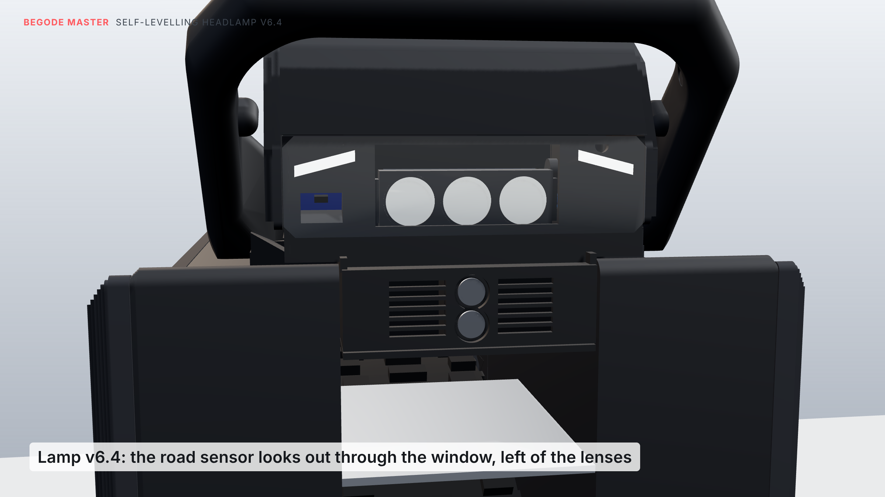

Everything is checked against the model of your wheel built from your caliper measurements
(`../reference/MEASUREMENTS.md`). Prices and shops: [`PARTS.md`](PARTS.md). Test plan and log:
[`TESTING.md`](TESTING.md).

## How it's built

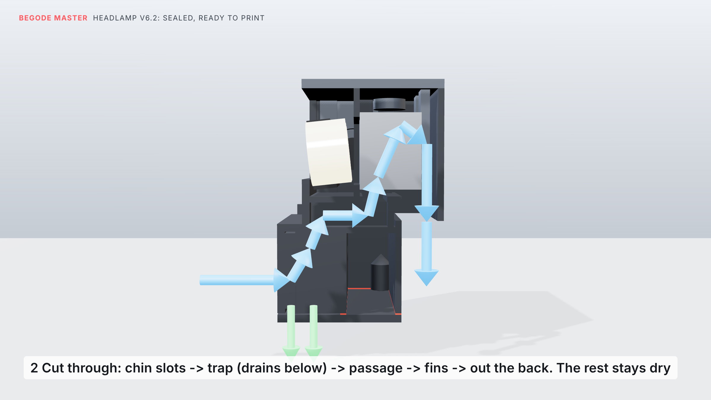

- **LEDs, fixed:** the three stars sit on the finned aluminium bar, which is clamped behind a wall (the
  bulkhead) inside the lamp. The LEDs look forward through a window in that wall. Their side is dry; the fins
  behind are in the cooling duct. A bead of silicone seals the bar's face to the wall.
- **Lenses, tilting:** the three lenses sit in a printed frame. It turns on a sealed 6800-2RS ball bearing on the
  left and on the servo's shaft on the right. The pivot runs through the LED chips, so turning the lenses turns
  the beam with them.
- **The lens gap:** the lenses stand 2 mm off the LED boards so they can swing without touching. Some light
  escapes through that gap. By my estimate, 10–15 % (so about 1000–1100 lm instead of 1200); the bench test
  in [`TESTING.md`](TESTING.md) measures the real figure.
- **Hard stops:** a lug on the frame meets stops at ±12°; the firmware keeps the lenses within ±10°.
- **Control:** about 200 times a second, the ESP32 reads the gyro (MPU-6050) and works out how far the wheel is
  pitched. The servo turns the lenses the other way, so braking, accelerating and bumps are cancelled
  completely. The beam stays at the aim you set (default 2° below level).
- **Hills (v6.4):** a VL53L1X laser distance sensor sits in a little hood behind the left of the face. It looks
  25° down through the main window at the road about 1.3 m ahead. From that distance and the wheel's pitch,
  the lamp works out the slope you are on (20 times a second, smoothed over about a second, the odd pothole
  thrown out). It then tips the beam by that slope, so the beam keeps its angle to the road. Because the
  sensor measures the road itself, a small error in the gyro's pitch cancels out.
  - Without a good reading for 1.5 s (a dirty window, grass, a wet road that acts like a mirror), it eases
    back to plain levelling.
  - The window was the obvious place: if it is too dirty for the sensor, it is too dirty for the light too.
    Tilted 25°, the window's own reflection goes down and away from the sensor's receiver.

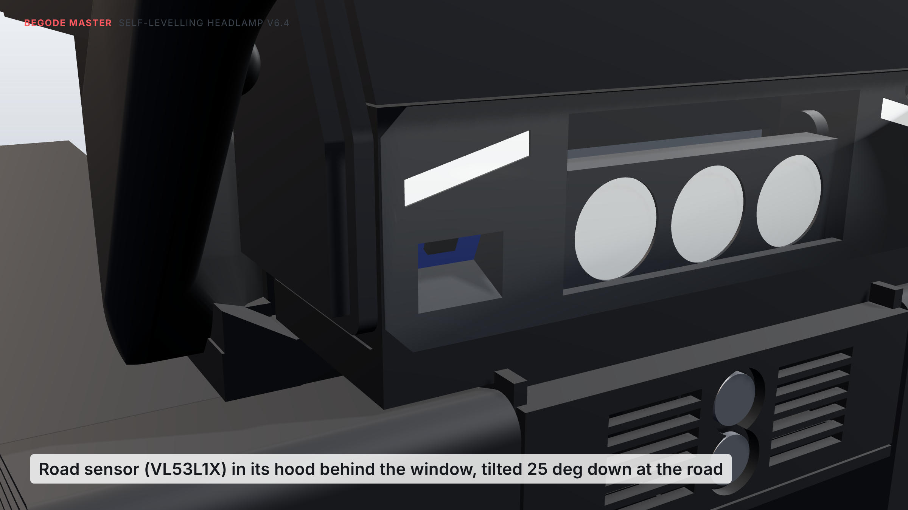

### Where the air, water and sand go

1. **In:** through the slots in the chin, either side of the buttons.
2. **Trap:** into a chamber behind the chin. Water and sand drop to the bottom and run out through the drain
   slots in the lid; the air turns upward.
3. **Passage:** back through a passage under the lenses (walled off from them).
4. **Fins:** up through the floor into the heat sink's fins.
5. **Out:** down the back of the lamp into the space between the shells.

The dry spaces are sealed by:
- **the inside of the window and the lenses:** the window's foam tape, the bulkhead and the bar's silicone
  seal;
- **the side bays (servo, bearing, drivers):** the inner walls;
- **the electronics box:** the lid, sealed with foam tape on the box's wall edges;
- **the buttons:** a closed box behind the chin.

The wires pass between dry spaces only: from the LEDs through the left pivot pocket into the left side bay.
The road sensor's hood joins the inside of the window to the left side bay, and both are dry.

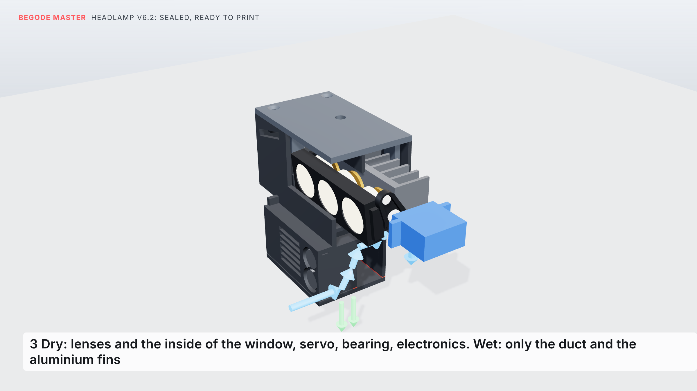

## How far it levels

- **The lenses tilt ±12°** about the line through the three LED chips: 24° in all, between two hard stops at
  ±12.4°. Only the lens frame moves; the LEDs stay on their heat sink.
- **The firmware uses ±10°**, so there are 2° in hand before the stops, and the servo never pushes against them.
  The wheel can pitch 10° either way and the beam stays where you aimed it.
- **What that means on the road:** the lenses sit about 0.61 m above the ground. Aimed 1.5° down, the beam's
  centre lands about 23 m ahead, and 1° of aim moves it about 35 cm at 20 m. Without levelling, braking with
  the nose 5° down would pull it in to about 5 m (10° down: about 3 m), and accelerating 5° nose-up would lift it
  3.5° above level, into oncoming eyes.

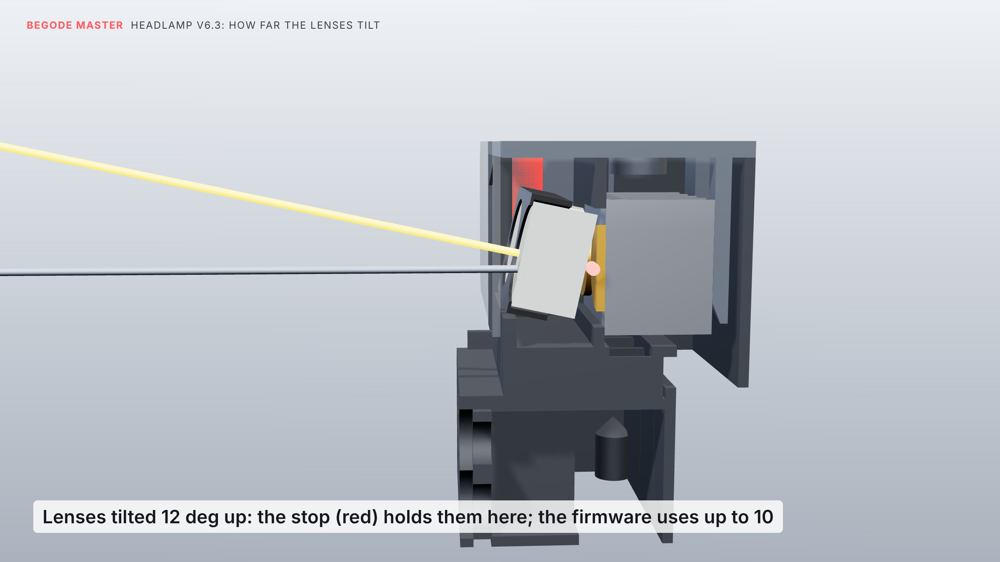
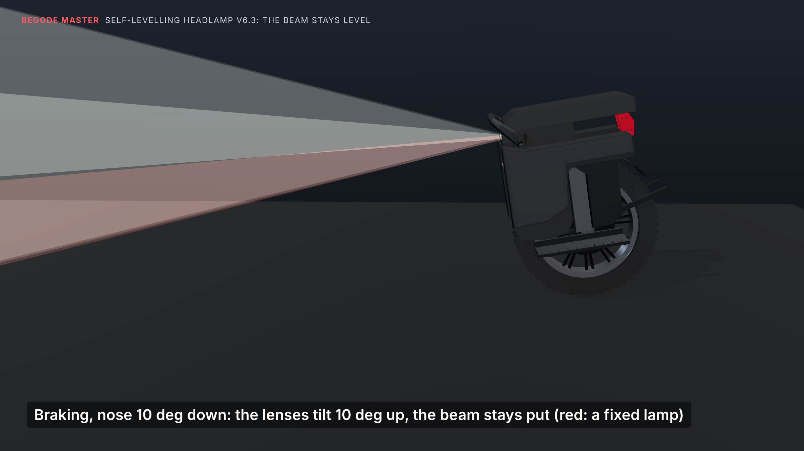

The other pictures: `renders/tilt_level.png`, `tilt_down.png`, `level_riding.png`, `level_accelerating.png`.

**Hills (v6.4):** without the road sensor, a beam aimed 2° down would hit a 10 % climb (5.7°) about 4.5 m
ahead instead of about 17 m. On a 10 % descent it would never come down to the road at all; it would shine out
into the eyes of anyone coming up. With the sensor, the beam tips by the slope.

The ±10° covers braking or a hill comfortably. If you brake hard on a steep descent, the two add up, and past
10° the beam follows the wheel by the difference.

**Dipping, and why there is no cut-off:**
- A real low beam has a flat top edge (a cut-off), like a car's. The bike-light lenses that do this
  (LEDiL FILIPPA-STVZO) are 33 mm across. The stock opening is 36.8 mm tall, and a 33 mm lens swinging ±12°
  needs about 40 mm.
- So the servo dips the beam instead. Dipped, it drops 4° below your aim, which puts the top edge of the
  10° spot about 1° below level, under oncoming eyes.
- High beam lifts it 4° above your aim, for empty roads.

**From the rider's eyes:** `renders/rider_pov.mp4` (14 s; `rider_pov.gif` is a smaller copy) is the view standing on
the wheel at night: cruising, hard braking (nose 9° down), accelerating (nose 7° up) and a stretch of broken asphalt.
The big picture is this lamp; the red-framed inset is the same ride with the lenses fixed. The lenses move by the
firmware's rule: aim (2° down) minus the pitch, held to ±10°, at most 400°/s. The levelled pool of light stays where
it was; the fixed one runs in to your front tyre when you brake and up into the trees when you accelerate.

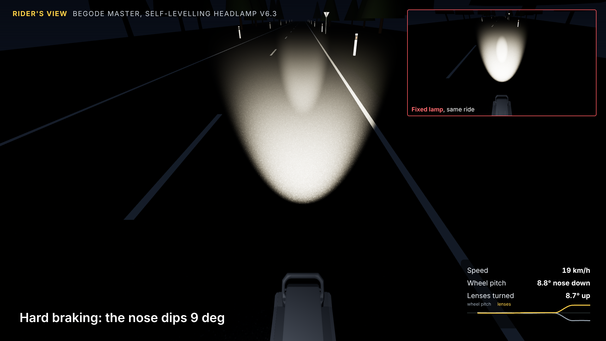

## The buttons

Two buttons sit one above the other in the middle of the chin, so either hand reaches them: **+** on top,
**−** below. They sit in pockets below the surface, so a knock or a drop can't press them. The lamp also
ignores any press shorter than 0.4 s, and any press while the wheel moves or lies on its side.

| Press | Does |
|---|---|
| **+** tap | aim 0.5° higher; the beam moves as you press |
| **−** tap | aim 0.5° lower |
| **+** hold 3 s | brightness 50 → 70 → 85 → 100 % (1–4 blinks) |
| **−** hold 3 s | mode: auto → beam on → running lights only (1 / 2 / 3 blinks) |
| both, tap | USB charger off / on (1 / 2 blinks) |
| both, hold 3 s | calibrate: wheel upright on flat ground (3 blinks) |
| both, hold 6 s | Wi-Fi settings page on for 10 minutes (4 blinks) |
| both, hold 10 s | back to factory settings |

The blinks are the running lights. While you hold, they flash once at 3, 6 and 10 s, so you know when to let go.

## Riding buttons (on the handle, v6.4)

Two sealed buttons sit on the back of the handle's right leg (the side facing you), at the height of the USB
port: **▲** the upper one, **▼** the lower. They sit 1 mm down in a dish, so a knock doesn't press them, and
a gloved finger finds them. Unlike the chin buttons, they work while you ride.

| Press | Does |
|---|---|
| **▲** tap | beam one step up: dipped → main → high |
| **▼** tap | one step down: dip it when someone comes towards you |
| **▲** hold | flash: high beam while you hold it |

The beam moves at once; you see it on the road. It starts on *main* every time the wheel is switched on.

**Why on the back of the leg:**
- You asked for the leg's inner face, by the USB port. Below the port, the cover leaves only 9–15 mm in front
  of that face: no room for a gloved finger. Above it, the face curves away into the grip's inside corner.
- The back of the leg, at the port's height, has nothing in front of it and faces you.
- A fall onto the side or the front never reaches it.

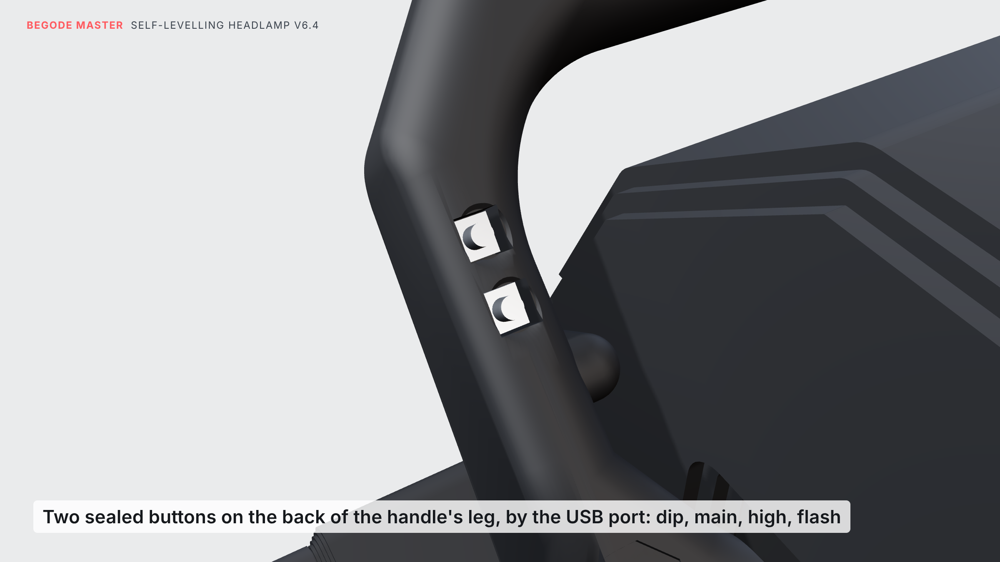

They are C&K KSC6 tact switches, sealed to IP67, 6.2 mm square. Each sits in a square pocket, with its wires
going through a short hole into the USB wire's channel. A dab of silicone over its feet seals and holds it.
Their three wires (▲, ▼ and a shared ground) run with the USB wire into the lamp.

Don't hold ▼ while you switch the wheel on. It shares the ESP32's boot pin, and the lamp would wait to be
programmed: switch off and on again.

## The USB charger

The USB-C port is on the inside of the handle's right leg, near the top, facing into the handle's opening
(handle v16, braced in v17). When the wheel falls on its side, the leg's outer face takes the ground and the port stays out of
the way. The plug goes straight in, into a small rounded well in the leg's face, and a cable up to 50 mm long
before its bend clears the cover. It's a bare USB-C receptacle pressed into a tight slot from that side; its
wires run inside the leg and through the lamp tab's braced root, and come up through the tab into a hole in the
housing's side floor, with a grommet. A silicone USB-C dust plug closes it when you're not charging. Use `master_handle_v18_left.stl`
instead if you want it (and the riding buttons) on the left.

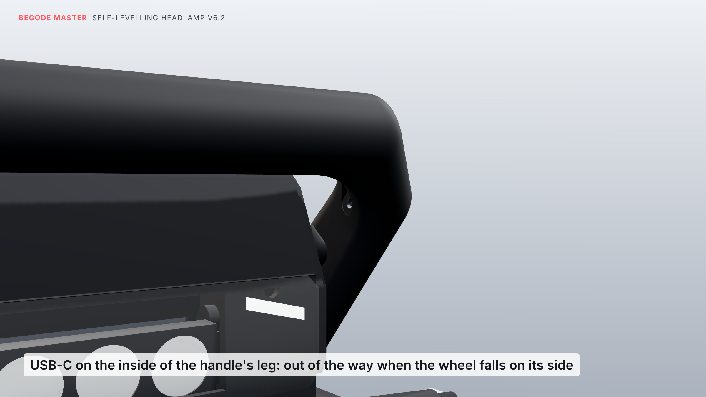

- **Power:** it gives 5 V at up to 1.5 A, about 7.5 W.
- **Sharing with the lamp:** an INA219 measures what the whole lamp draws. When lamp and charger go over the
  limit (20 W by default), the beam is turned down. If the beam would drop below 70 % at night, the charger
  pauses for a minute instead. By day the beam is off, so the charger has the room to itself.
- **Turning it off:** tap both buttons.

## Bought parts

| Part | Qty | Notes |
|---|---|---|
| Luminus SST-20 (or Cree XM-L2 / XP-L), 3 V, on a **16 mm** copper star | 3 | 4000–5000 K |
| 20 mm TIR optic for a 16 mm star | 3 | 1 × 10° round (centre, reach), 2 × **elliptical** wide (sides) |
| Finned aluminium heat-sink bar | 1 | flat face 25 mm tall, fins no deeper than 20 mm, fins running front to back. **Cut to 62 mm wide** |
| Clear polycarbonate sheet, 1.5 mm | 1 | the window (`stl/lamp64_window_1.5mm_polycarbonate.svg`) |
| Thin double-sided foam tape, 0.5 mm, 3–5 mm wide | | the window; strips on the inner walls' top edges under the top plate and on the electronics box's wall edges under the lid |
| Neutral-cure clear silicone | | seals the LED bar's face to the bulkhead |
| Mean Well LDD-1500L (or LDD-1000L / PT4115, see `PARTS.md`) | 3 | one per LED |
| ESP32-C3 SuperMini | 1 | |
| MPU-6050 (GY-521) | 1 | |
| VL53L1X laser distance sensor on a Pololu carrier (#3415, 12.7 × 17.8 mm), no header pins | 1 | the road sensor (v6.4) |
| C&K KSC6 sealed tact switch (IP67, 6.2 × 6.2 mm, hard actuator, e.g. KSC621J LFS) | 2 | the riding buttons on the handle (v6.4) |
| INA219 module (0.1 Ω shunt) | 1 | power guard |
| MG90S metal-gear servo | 1 | |
| 6800-2RS ball bearing (10 × 19 × 5 mm, sealed) | 1 | the lens frame's pivot |
| MP1584EN buck module | 2 | one at 5.0 V (electronics), one at 5.1 V (USB) |
| Small logic-level MOSFET module (AO3400 type), **at most 18 × 11 × 4 mm** | 2 | running lights; USB charger switch. The D4184 boards with screw terminals don't fit beside the servo |
| 8 mm sealed momentary push button (IP67, flat head) | 2 | the chin buttons |
| USB-C female receptacle, solder-tab or on a small board, **6 pins (VBUS, GND, CC1, CC2)**; no resistors on it | 1 | the handle port: shell 8.9 × 3.3 mm, up to 7.5 mm deep, board up to 13 × 8 mm |
| Silicone USB-C dust plug | 1 | closes the port in the rain |
| 22 kΩ resistors | 2 | CC1 and CC2 to VBUS at the socket |
| 5 V white LED strip, 2835, 120/m | about 14 LEDs | daytime running lights |
| GL5528 LDR + 10 k; 10 k NTC (B3950) + 10 k | | light sensor, heat-sink temperature |
| Plug that matches the wheel's lamp plug (stock: yellow JST-XH, 2 pin) | 1 | |
| Rubber grommets for a 6 mm hole | 2 | the wheel's power cable (back wall), the USB and button wires (side floor) |
| Conformal coating spray (acrylic or silicone) | | a thin coat on every circuit board |
| 26 AWG silicone wire; 2-core 24 AWG silicone wire, about 40 cm; three 28 AWG wires, about 40 cm | | the 28 AWG wires: the handle's buttons |
| 2-part epoxy; CA (super) glue; a little neutral-cure silicone | | the USB socket in the handle (glue only if the press fit is loose, silicone round its edge); the riding buttons (silicone over their feet); the servo horn in the lens frame |

## Printed parts

Every file is already lying on the bed the way it should print: load it, don't rotate it.

| File | Qty | Material | Lies | Supports |
|---|---|---|---|---|
| `stl/lamp64_housing.stl` | 1 | black ASA, 4 walls | open top on the bed | yes, see below |
| `stl/lamp64_top_plate.stl` | 1 | ASA/PETG | top face on the bed, tongues and fingers up | none |
| `stl/lamp64_lens_frame.stl` | 1 | PETG/ASA | front face on the bed (the lenses' lips are the first layers) | none |
| `stl/lamp64_lid.stl` | 1 | ASA/PETG | flat | none |
| `stl/master_handle_v18_right.stl` (or `_left`) | 1 | PETG/ASA, 5 walls, 40 % infill | flat: legs and grip on the bed | from the bed only, and a brim |
| `stl/master_handle_bolt_cover_right.stl` and `_left.stl` | 1 + 1 | PETG/ASA, as the handle | flat side down | none |

## Printing

- **Handle's lamp tabs (v17):** the first printed handle snapped both tabs where they leave the leg. Each tab
  now has a triangular gusset underneath, 5 mm deep at the root and tapering out under the screw, and a sloped
  fillet over its root. The USB wire runs inside that thicker root, not in a groove along it. The tabs are still
  4 mm thick where the lamp sits on them.

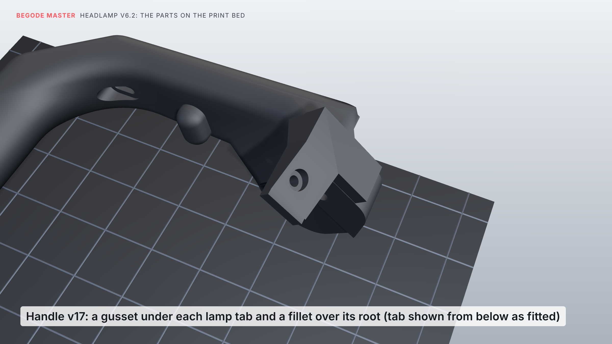

- **Nozzle 0.4 mm, layers 0.2 mm or finer.** The lens frame's lips are 0.6 mm, three layers at 0.2.
- **Housing:**
  - The supports it needs all stand on the bed or on its own ledges, inside the side bays and in the LED bar's
    window, and they come out through the open top.
  - The air duct and the electronics box need none: ribs under the lenses' floor and cones under the lid's
    screw posts let those surfaces bridge. Keep "bridges" on (the side-bay floors bridge about 20 mm).
  - ASA warps, so print it in an enclosure.
  - "Fuzzy skin" on the outside gives the shells' grainy look.
- **Handle:** it lies with its legs and grip flat, so every layer runs along them. A fall onto the grip then
  pulls along the plastic, not between layers. It rests on its rounded underside, so use supports from the bed
  (tree supports are easiest to remove) and a 5 mm brim. The bolt holes then lie sideways and can come out a
  little oval: run a drill of their own size through them.
- **Preview:** `renders/print_*.png` show each part on the bed as exported, and the support a slicer adds in
  red (`print_housing_supports.png`, `print_handle_supports.png`). The housing's supports fill its two side
  bays (about 40 mm tall) and the LED window: about 15 g with tree supports, all reachable through the open top.

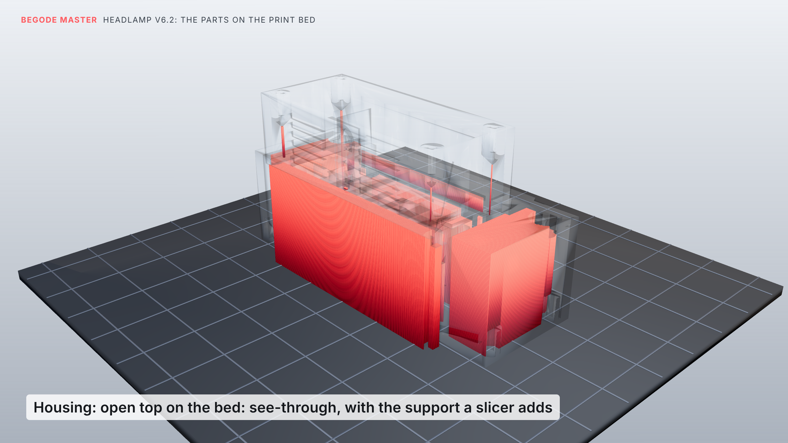

- **The small round knob inside each leg** is part of the stock handle: it holds the top cover's edge. Leave it.
- **Check before slicing:** `source/print_check.py` checks every STL the way a slicer would see it. It looks
  for closed solids, thin walls, slits, and what needs support and where that support stands.

## Hardware

- **Lamp to cover:** the stock lamp's 2 M4 screws, into 2 **M4 heat-set inserts** (5.7 mm long, 5.6 mm OD) in the
  top plate's bosses.
- **Top plate to housing:** 4 × M3 × 8 countersunk.
- **Lamp to handle:** 2 × M3 × 10 self-tapping, up through the handle's lamp tabs into the housing. Their heads sit
  in counterbores in the gussets under the tabs.
- **Lid:** 4 × M3 × 10 self-tapping.
- **Servo horn:** glued into its recess with a drop of CA glue. Its two little screws aren't used: they would
  stick out of the frame's inner side. The servo itself needs no screws.
- **Chin buttons:** their own nuts.
- **Road sensor:** foam tape on its hood's rim. **Riding buttons:** silicone.

## Wiring

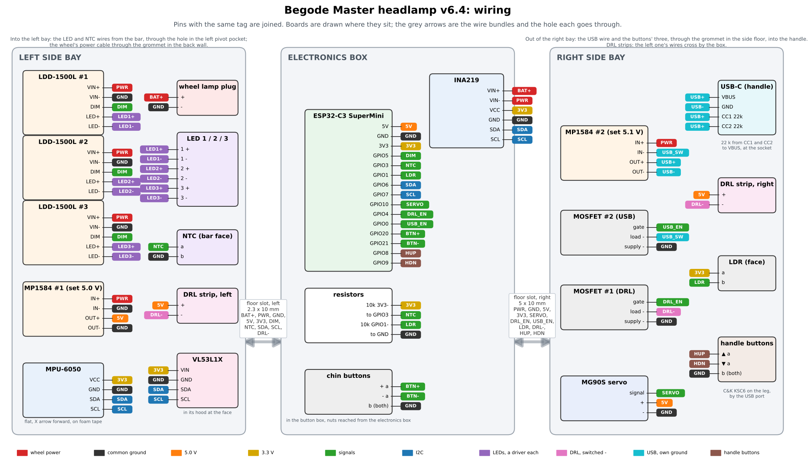

Pins with the same tag are joined. The same connections as a list:

```
wheel lamp plug + ── INA219 VIN+      INA219 VIN- ──┬── LDD-1500L #1, #2, #3  VIN+
                                                    ├── MP1584 #1 IN+   (electronics, 5.0 V)
                                                    └── MP1584 #2 IN+   (USB, 5.1 V)
wheel lamp plug - ──── common ground
MP1584 #2 IN- ── MOSFET module #2, load - side      (its supply - to ground, its control to GPIO0)
MP1584 #2 OUT+ / OUT- ── 2-core wire through the handle ── USB-C socket VBUS / GND
                         at the socket: 22 k from CC1 to VBUS, 22 k from CC2 to VBUS
LDD #n  LED+ / LED- ── LED #n            (each LED on its own driver; don't join the LED- wires)
LDD DIM #1 + #2 + #3 ── GPIO5            (all three together)
MP1584 #1 OUT 5.0 V ──┬── ESP32-C3 5V, servo red, MOSFET module #1 DC+ (→ both DRL strips)
ESP32 3V3 ──┬── MPU-6050 VCC, INA219 VCC, VL53L1X VIN
            ├── 10 k ── GPIO3 ── NTC ── GND (NTC glued to the bar's face, above the middle LED)
            └── LDR ── GPIO1 ── 10 k ── GND
GPIO6 SDA / GPIO7 SCL ── MPU-6050, INA219 and VL53L1X (it joins the MPU-6050's wires in the left bay)
GPIO10 ── servo     GPIO4 ── MOSFET module #1
chin button + ── GPIO20 and GND          chin button - ── GPIO21 and GND
handle ▲ ── GPIO8 and GND                handle ▼ ── GPIO9 and GND   (3 wires up the handle: ▲, ▼, GND)
```

Keep the USB side's ground (MP1584 #2 OUT−, the socket's GND) away from the common ground. The MOSFET module
switches the charger by cutting its ground.

## Assembly

1. **LED bar:**
   - Cut the heat sink to 62 mm wide.
   - Glue the three stars to its face with thermal adhesive: centred top to bottom, 21 mm apart, the middle
     one in the middle.
   - Glue the NTC to the face above the middle star.
   - Solder the wires.
2. **Housing, open top up:**
   - Glue the LED strip rows behind the two angled running-light slots, LEDs facing forward.
   - Push the LDR into its hole near the top of the face.
   - Solder four wires to the VL53L1X carrier (VIN, GND, SDA, SCL), peel its sensor's protective film, and stick
     it on the rim at the back of the hood, left of the lenses, with thin foam tape all round. The sensor (the
     small black part) faces forward and down through the hood. It goes in from above, tilted, before the top
     plate.
   - Fit the two chin buttons, + on top, from the front. Do their nuts up from inside the button box: reach in
     through the electronics box (lid off) and the opening in the divider.
   - Push the grommet into the power-cable hole in the back wall.
3. **LED bar in:**
   - Run a thin bead of silicone round the edge of the bar's face.
   - Feed the LED and NTC wires forward through the bulkhead's window.
   - Lower the bar in behind the bulkhead and push it forward so the stars sit in the window. The top plate's
     fingers hold it there later.
   - Lead the wires along the bulkhead's front to the hole in the left pivot pocket, into the left side bay.
4. **Lens frame and servo, on the bench:**
   - Push the three lenses into the frame from behind (a drop of glue holds them).
   - Press the 6800-2RS onto the pin until it sits against the shoulder.
   - Set the servo to the middle of its travel. Glue the horn into the recess on the frame's right hub with a
     drop of CA glue (its arm points up, flat side against the recess's floor). Once the glue has set, press
     the servo's shaft into the horn with the frame level.
5. **Lens frame in:** lower the frame and servo in together: the bearing into its seat in the left wall, the
   servo's shaft into the slot in the right wall, its tabs into the slots in its posts. Nothing needs forcing.
   Tilt the frame by hand: it should swing freely and stop softly on the stops.
6. **Top plate:**
   - Lay foam tape along the top edges of the bulkhead and the short walls beside the pivot pockets. These are
     the edges where dry meets wet.
   - Melt the M4 inserts into the plate's bosses. Hold the LED bar forward and set the plate on: its three
     fingers drop in behind the fins and keep the bar pressed to the bulkhead. Fix it with 4 × M3 × 8
     countersunk.
7. **Electronics:**
   - Give every board a thin coat of conformal coating first. Keep it off connectors and the LDR.
   - **Left side bay:** the road sensor at the front, in its hood. Behind it, from the bottom up: LED driver
     #1 against the outer wall, buck #1, driver #3, driver #2 at the top, and the MPU-6050 flat on top (X arrow
     forward). Join the sensor's SDA, SCL, 3V3 and GND to the MPU-6050's. Keep the strip of space behind the
     running-light slot clear for its LEDs.
   - **Electronics box:** the INA219 and the ESP32 on edge against the divider, side by side. The ESP32's USB-C
     faces down, so you can flash it with the lid off.
   - **Right side bay:** buck #2 and the USB MOSFET under the servo, the DRL MOSFET above it.
   - Keep the space over the two floor slots clear: the wires between the bays and the box go through them
     (left slot 2.3 × 10 mm, a flat bundle; right slot 5 × 10 mm).
   - Fix everything with foam tape.

   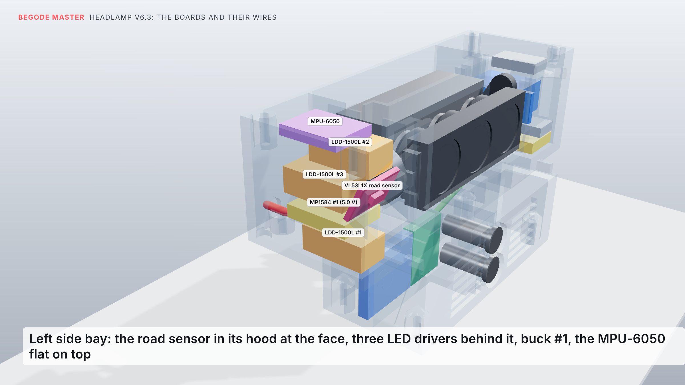
   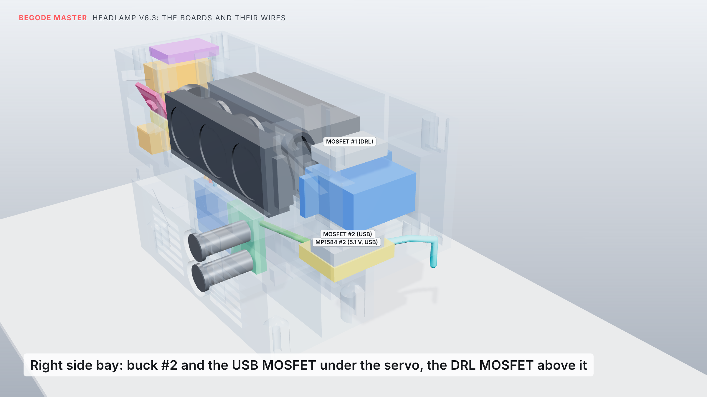
   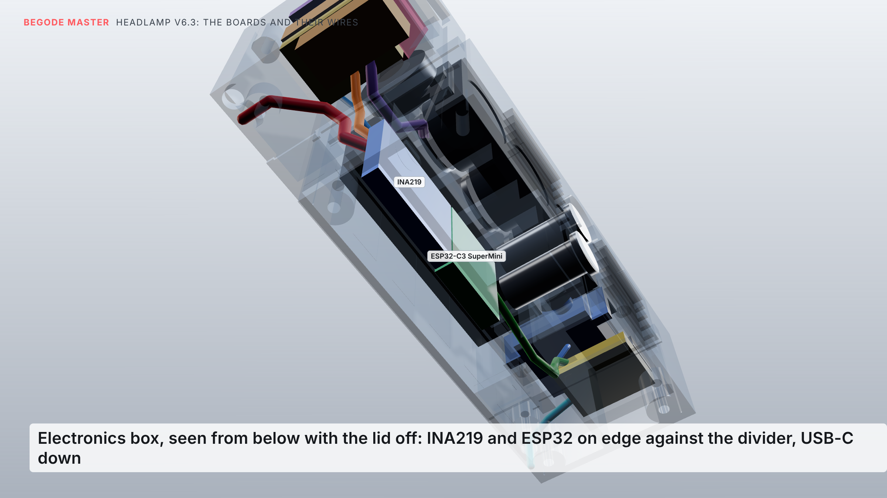
8. **USB and riding buttons in the handle:**
   - Push the 2-core wire and the three 28 AWG wires into the hole in the top of the lamp tab (right side) and
     feed them through the handle's channel, up the leg. The 2-core one comes out through the slot in the well
     on the leg's inner face; one thin wire comes out of each button pocket on the leg's back, and the third
     (ground) goes to both.
   - Solder each KSC6: one contact to its own wire, the other to the ground wire. Press it into its pocket,
     actuator out, and put a dab of silicone over its feet and the wire hole. Its top ends up 1 mm below the
     dish.
   - Solder it to the receptacle's VBUS and GND, and a 22 k resistor from each of CC1 and CC2 to VBUS.
     Sleeve the joints with heat-shrink and keep them in line behind the receptacle.
   - Pull the wire back from the tab end, so the joints go ahead into the chamber behind the slot, and press
     the receptacle into the slot, mouth facing out, until its front is level with the well's floor. It's a
     press fit: if it's too tight, file the slot lightly; if it's loose, a drop of CA glue holds it.
   - Run a thin ring of silicone round the receptacle's edge, so water can't get behind it. Check a phone
     charges, and fit the silicone dust plug.
9. **Window:** lightly sand the window's inside where it covers the two running-light slots, so it spreads
   their light. **Don't sand it in front of the road sensor**, left of the lenses: it has to see through clearly.
   Foam tape round the edge of the face, press the window on, film off last.
10. **Into the wheel:** push the lamp up into the opening, screw the cover's two M4 screws into the inserts.
11. **Handle:**
    - Feed the USB and button wires up through the side-floor hole (grommet).
    - Bolt the handle on: on each foot, the bolt cover goes in its recess on the outside and the three bolts go
      through it, the foot and into the block (the covers are your stock part, and its mirror for the left).
    - Fit the two M3 screws up through the lamp tabs into the lamp.
    - Connect the USB wire to buck #2, and the button wires on through the right floor slot to the ESP32
      (GPIO8, GPIO9, GND).
12. **Lid:** foam tape along the bottom edges of the electronics box's walls (the divider, both sides, the back),
    then the lid, 4 × M3 × 10. The drain slots go under the trap, at the front.
13. **Firmware:**
    - Flash `firmware/headlamp6_firmware/headlamp6_firmware.ino` (Arduino IDE, board *ESP32C3 Dev Module*, USB
      CDC On Boot: Enabled). One library: *VL53L1X* by Pololu, from the Library Manager.
    - Stand the wheel upright on flat ground, hold both chin buttons 3 s to calibrate, then tap + or − to set the
      aim. Calibrating also measures the road sensor's real angle, so do it on flat ground with nothing in front.

## What I checked (against the measured wheel)

- **Fit:** the housing, top plate, lid and window stay clear of the shells, the cover, the controller and the motor
  cable. With the suspension bottomed out, the lid stays 4.0 mm above the cross plate.
- **Lenses:** they swing ±12° without touching the housing, the top plate, the window, the LED bar or the servo.
  The lens bases stay 0.65 mm off the LED boards at ±10° and 0.35 mm at ±12°.
- **Stops:** the lug meets the stops at ±12.4°. Pushed to ±13.5°, only the lug and the stops meet.
- **Putting it together:**
  - The lens frame and servo come straight out of the open housing with nothing touching, so they go in the
    same way.
  - The LED bar goes in 2.5 mm behind the bulkhead and slides forward; the plate's fingers sit right behind its fins.
  - The top plate lifts straight off.
- **Sealing:** in the model, I filled every space that outside air can reach.
  - It reaches the trap, the passage, the fins and the rear exit.
  - It doesn't reach the inside of the window, the lens bay, the pivot pockets, either side bay, the electronics
    box or the button box. That counts the window tape, the lid's tape, the grommets and the screws as fitted.
  - The narrowest point of the duct is 355 mm² (trap to passage), about a 21 mm hole.
- **Road sensor (v6.4):** its board and chip clear the housing, the top plate and the lenses over their whole
  swing. Its 27° view passes the hood and the face without touching them. It leaves the face inside the
  window's tape ring (y −5.4 to 5.4, w −60.5 to −45.7). Every board still packs into the dry spaces with it
  there (the LED drivers moved back about 8 mm), with the strip behind each running-light slot kept clear.
- **Riding buttons (handle v18):** each switch pocket leaves 3.3–4.6 mm of the leg between it and the USB wire's
  channel. Their wire holes open into that channel, and they stay clear of the USB well.
- **Handle v17:** it clears the wheel (suspension bottomed and at rest), the lamp and the cover, in both the
  right- and left-port versions. Its lamp tabs' gussets stay 2 mm off the shells. A USB-C plug up to 50 mm long
  (before its cable bends) goes fully into the port and clears the cover. The bolt covers sit in the feet's
  recesses without overlapping them.
- **Drops:** I tested about 18,000 fall directions. In every one, the handle grip, the shells or the tyre touch
  the ground first, and the lamp stays at least 19.8 mm clear (25 mm falling straight forward).
- **Parts:** every STL is one closed solid with no zero-area triangles, lying flat and centred.
  `print_check.py` finds no wall under 0.4 mm, no floor under one layer and no slit under 0.3 mm.
- **Firmware:** it compiles against stand-in Arduino headers. I ran the buttons through a simulation, and for
  v6.4 a test harness ran the riding buttons and the road sensor:
  - a tap steps the beam, a hold flashes, and a 10 ms glitch does nothing;
  - on a 5.7° climb, the slope reaches 3.4° in 1 s and 5.6° in 4 s;
  - one pothole reading is thrown out, and hard braking doesn't upset the slope;
  - with no readings, it eases back to level;
  - calibrating on flat ground gives the sensor's 25°.

  The slope maths was checked against the scene's geometry. It hasn't run on real hardware yet.

## Worth knowing

- **Rinse the chin now and then.** The trap catches sand on purpose; a quick rinse with the lid on flushes it out
  through the drains.
- **Heat:** the cooling works best when riding (air comes in through the chin). When you stand still with the
  beam on, the heat-sink sensor turns the beam down. That's expected.
- **Keep the window clean on the left too:** that's where the road sensor looks out. On a wet road at night
  (a mirror to its laser) or on grass, it may get no reading; the lamp then just levels, as v6.3 did.
- **Top cover:** the lamp is screwed to it, like the stock lamp. Take out the two top screws before lifting the
  cover.
