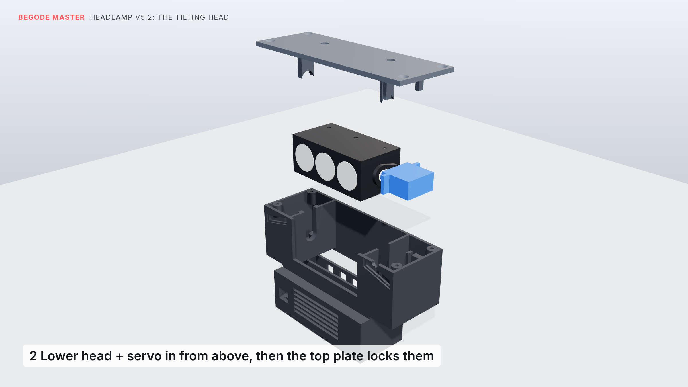

# Lamp v5.2: kolme LEDiga isetasandav esituli originaallambi avas

Originaallamp võetakse välja ja see lamp istub tasapinnaliselt selle avasse pealmises kattes. Topsihoidjat
enam ei ole. Ingliskeelne versioon: [`BUILD_GUIDE.md`](BUILD_GUIDE.md).

- **Valgus:** kolm LEDi ja optikat reas: keskel kitsas optika kaugeks valguseks, külgedel kaks laia.
- **Tasandamine:** kõik kolm on ühel ribidega jahutusradiaatoril, mida servo kallutab ±10°. Nii püsib
  valgusvihk paigal, kui ratas pidurdamisel, kiirendamisel, löökaukudes ja mägedes kaldub. Teeandur,
  güroskoop, päevatuled, päeva/öö ümberlülitus ja telefoni seadete leht töötavad nagu varem.
- **Heledus:** umbes **1200 lm** vaikimisi 90 % juures, umbes 2,5 korda heledam kui ühe LEDiga v4.
- **Elektroonika:** see on karbis, mis ripub külgkatete vahele, ja selle kaas on all. Elektroonikale pääseb
  ligi lampi välja võtmata.
- **Kinnitus:** lampi hoiavad katte kaks originaalset M4 kruvi ja kaks tugiriba, mis ulatuvad käepideme
  kõrvadeni.
- **Välimus (v5.1):** läbipaistev 1,5 mm polükarbonaadist aken istub tasapinnaliselt avas, 0,7 mm katte
  esiservast tagapool, musta esipaneeli ees. Päevatuled on kaks kaldus valgusjoont, mis järgivad Masteri
  tahulist kuju. Aken hoiab vihma ja liiva optikast eemal.
- **Kukkumised:** ükskõik mis suunas ratas kukub, puudutavad maad esimesena käepide, külgkatted või rehv.
  Lamp jääb vähemalt 20 mm kaugusele (otse näoli kukkudes 25 mm).


Kõik on kontrollitud ratta mudeli järgi, mis on tehtud sinu nihikuga mõõdetud mõõtude põhjal
(`../reference/MEASUREMENTS.md`).

## Kuidas tasandamine töötab



- **Pöördtelg:** pea (kolm LEDi ja optikat ribidega radiaatoril) ripub korpuse kahe sisemise seina vahel
  ühel teljel, mis läheb risti üle ratta. Vasakul pöörleb pea õõnes tihvt 4 mm laagris; LEDide ja
  temperatuurianduri juhtmed tulevad sellest läbi, nii et väljaspool midagi ei paindu. Paremal on servo võll
  samal teljel ja selle hoob on pea külge kruvitud.
- **Ajam:** hammasrattaid ega hoobasid pole: servo pöörab pead otse. Pea liigub ±10° ja püsivara peatab ta
  seal.
- **Juhtimine:** umbes 200 korda sekundis loeb ESP32 güroskoopi (MPU-6050) ja arvutab, kui palju ratas
  kaldub. Teeandur (VL53L1X) mõõdab ees oleva tee kallet. Püsivara pöörab pead vastupidi, nii et valgusvihk
  püsib sinu seatud suunas (vaikimisi 2° tee alla), kui pidurdad, kiirendad, sõidad üle löökaukude või mäest
  üles ja alla. Kui ratas kukub, hoiab pea lihtsalt sinu seatud suunda.
- **Koormus:** pea kaalub umbes 70 g ja selle raskuskese on telje lähedal, nii et servol on vähe tööd.
  Metallhammasratastega MG90S on täiesti piisav.
- **Kinnitus:** korpus on pealt lahti. Pea ja servo lähevad sisse ülevalt ühe tervikuna: tihvt vasaku seina
  pilusse, servo võll parema seina pilusse ja servo kõrvad oma kahe posti pilusse. Kaanepaneeli keeled lähevad
  nendesse piludesse, nii et midagi välja tõusta ei saa, ja paneeli hoiavad neli peitpeaga kruvi. Servo ei vaja
  oma kruve.

Iga sammu pildid: `renders/render_v52_mechanism_1.png` … `_4.png`.

## Ostetavad osad

Hinnad ja poed: [`PARTS_et.md`](PARTS_et.md).

| Osa | Tk | Märkus |
|---|---|---|
| Luminus SST-20 (või Cree XM-L2 / XP-L), 3 V, **16 mm** vaskplaadil | 3 | 4000–5000 K |
| 20 mm TIR-optika 16 mm plaadile | 3 | 1 × 10° ümar (keskele, kaugele), 2 × **elliptiline** lai (külgedele: lame ja lai valgusriba) |
| Läbipaistev polükarbonaatleht, 1,5 mm | 1 | lõika malli `stl/lamp52_window_1.5mm_polycarbonate.svg` järgi (133 × 35,8 mm, kaldnurkadega) |
| Õhuke kahepoolne vahtteip, 0,5 mm, 3–5 mm lai | | hoiab akent lambi esipaneelil ja tihendab selle |
| Ribidega alumiiniumradiaator | 1 | lame pind **64 × 25 mm**, kuni 20 mm sügav, ribid eest taha. Lõika profiilist. |
| Mean Well LDD-1500L | 3 | üks iga LEDi kohta; töötab ka ratta 6,5 V hämarrežiimis |
| ESP32-C3 SuperMini | 1 | |
| MPU-6050 (GY-521) | 1 | |
| VL53L1X moodul (13 × 18 mm) | 1 | teeandur |
| MG90S metallhammasratastega servo | 1 | |
| MP1584EN pingemuundur, seatud 5,0 V peale | 1 | |
| MOSFET-moodul (D4184 / AO3400) | 1 | päevatuled |
| 5 V valge LED-riba, 2835, 120/m | umbes 14 LEDi | päevatuled |
| GL5528 fototakisti + 10 k; 10 k NTC (B3950) + 10 k; 47 k + 10 k | | valgusandur, radiaatori temperatuur, ratta pinge |
| Ratta lambipistikuga sobiv pistik (originaal: kollane JST-XH, 2-pin) | 1 | |
| 26 AWG silikoonjuhe | | 8 juhet läbi õõnsa pöördtihvti |

## Prinditavad osad (PETG või ASA, 4 seina)

| Fail | Tk | Kuidas |
|---|---|---|
| `stl/master_handle_v12.stl` | 1 | sinu käepide + kaks tugiriba taga. Külili, tugedega käepideme all |
| `stl/master_handle_top_cap_p2.stl` | 1 | sinu originaalkork |
| `stl/lamp52_housing.stl` | 1 | lahtine pealmine külg aluse vastas, nagu eksporditud. Must ASA, slaiseris „fuzzy skin“ sisse, et pind oleks külgkatete moodi teraline |
| `stl/lamp52_top_plate.stl` | 1 | pealmine pind aluse vastas, keeled üles, nagu eksporditud |
| `stl/lamp52_head.stl` | 1 | avatud tagakülg aluse vastas, nagu eksporditud |
| `stl/lamp52_lid.stl` | 1 | välimine pind aluse vastas, nagu eksporditud |
| `stl/lamp52_drl_diffuser_left.stl`, `stl/lamp52_drl_diffuser_right.stl` | 1 kumbki | valge või läbipaistev PETG, 100 % täide (kaldus valgusjooned) |

## Kinnitusvahendid

- **Lamp katte külge:** originaallambi 2 M4 kruvi, mis lähevad 2 **M4 sissesulatatavasse keermehülssi**
  (5,7 mm pikk, välisläbimõõt 5,6 mm). Sulata hülsid kaanepaneeli all olevasse kahte puksi.
- **Kaanepaneel korpuse külge:** 4 × M3 × 10 peitpeaga kruvi (isekeermestavad või tavalised, mis lõikavad
  plastisse ise keerme). Pead jäävad pinnaga tasa, katte alla.
- **Lamp käepideme külge:** 2 × M3 × 10 isekeermestavat kruvi, altpoolt läbi käepideme tugiribade korpusesse.
- **Kaas:** 4 × M3 × 8 isekeermestavat kruvi.
- **Lambi sees:**
  - 3 × M3 × 8 isekeermestavat (radiaatori ribidesse)
  - 2 väikest kruvi, mis tulevad servohoovaga kaasa (hoob pea külge)
  - servo ise kruve ei vaja: selle kõrvad on piludes ja kaanepaneel hoiab neid all

## Juhtmestik

```
ratta lambipistik + ──┬── LDD-1500L nr 1, 2, 3  VIN+
                      ├── MP1584 IN+
                      └── 47 k ── GPIO0 ── 10 k ── GND       (ratta pinge)
ratta lambipistik − ──── ühine maa
LDD nr n  LED+ / LED− ── LED nr n        (iga LED oma draiveril; LED− juhtmeid kokku ei ühenda)
LDD DIM nr 1 + 2 + 3 ── GPIO5            (kõik kolm koos)
MP1584 OUT 5,0 V ──┬── ESP32-C3 5V, servo punane, MOSFET-mooduli DC+ (→ mõlemad päevatule ribad)
ESP32 3V3 ──┬── MPU-6050 VCC, VL53L1X VIN
            ├── 10 k ── GPIO3 ── NTC ── GND (NTC liimitud radiaatori külge)
            └── fototakisti ── GPIO1 ── 10 k ── GND
GPIO6 SDA / GPIO7 SCL ── MPU-6050 ja VL53L1X      GPIO10 ── servo      GPIO4 ── MOSFET-moodul
```

**Võimsus:** kolm LEDi vaikimisi 90 % juures võtavad umbes 13 W. Päeval lisanduvad päevatuled umbes 3 W ja
ülejäänu umbes 1 W. See jääb ratta umbes 20 W lambiväljundi piiresse. Öösel lülituvad päevatuled
ääretuleks. Ära tõsta seadete lehel „Beam“ 100 % peale, kui sa pole pistikut mõõtnud ja see ei anna rohkem.

## Kokkupanek

1. **Pea:**
   - Liimi kolm LED-plaati soojusjuhtiva liimiga radiaatorile. Kitsas optika läheb keskele, kohakuti pea
     kolme avaga.
   - Liimi NTC radiaatori külge.
   - Lükka radiaator tagant pähe ja kinnita kolme M3 kruviga ribidesse.
   - Vii 6 LED-juhet ja 2 NTC juhet välja läbi õõnsa tihvti.
2. **Pea ja servo, laual:**
   - Sea servo käigu keskele: servotesteri keskasendiga või pööra võlli ettevaatlikult käega kahe otsa vahele.
   - Kruvi ühe õlaga hoob pea parempoolse puksi süvendisse.
   - Kui pea on loodis ja servo lamab selle kõrval (kõrvad loodis), suru servo võll hoova sisse. Hoova
     keskmist kruvi pole vaja: sellele ei pääse ligi ja korpus ei lase neil lahti tulla.
   - Viimase kraadi või paar sead hiljem telefoni lehel „Servo trim“ abil.
3. **Korpus,** lahtine pool üleval:
   - Liimi kaks kaldus hajutit oma süvenditesse, LED-riba read nende taha.
   - Lükka fototakisti oma avasse esipaneeli ülaosas. See vaatab välja läbi akna.
   - Lase pea ja servo koos sisse: tihvt vasaku seina pilusse, servo võll parema seina pilusse, selle kaks
     kõrva postide piludesse. Midagi ei pea jõuga suruma.
   - Vii tihvti otsast tulevad 8 juhet ja servo kaabel alla elektroonikakarpi.
   - **Kaanepaneel:** sulata kaks M4 hülssi selle puksidesse ja pane paneel peale. Selle keeled lähevad nelja
     pilusse. Kinnita 4 peitpeaga M3 kruviga.
4. **Elektroonikakarp:** pane kolm LDD-1500L, ESP32, MPU-6050 (lapiti, X-nool ette), pingemuundur ja
   MOSFET-moodul vahtteibiga pea all olevasse karpi. Lükka teeanduri plaat oma pilusse lõuaava kõrval oleva
   väikese tunneli taha. Selle ette ei tohi panna klaasi ega kilet; see jääb aknast väljapoole.
5. **Aken:** kleebi vahtteip ümber lambi esipaneeli serva ja suru polükarbonaadist aken selle vastu. Kaitsekile
   koori ära alles lõpus.
6. **Rattasse:** lükka lamp altpoolt avasse ja keera katte kaks M4 kruvi hülssidesse.
7. **Käepide:** kinnita nagu tavaliselt, siis keera kaks M3 kruvi läbi tugiribade lambi sisse.
8. **Kaas:** kinnita 4 × M3. Elektroonikale pääsemiseks võta see igal ajal maha.
9. **Püsivara:**
   - Laadi `firmware/headlamp5_firmware/headlamp5_firmware.ino` (Arduino IDE, plaat *ESP32C3 Dev Module*,
     Pololu „VL53L1X“ teek).
   - Ühendu WiFi-ga **Headlamp-xxxx** (parool **masterlamp**), ava **192.168.4.1** ja vajuta „Calibrate“,
     kui ratas seisab püsti tasasel maal.
   - Sea suund (vaikimisi 2° tee alla) ja heledus.

## Mida ma kontrollisin (mõõdetud ratta järgi)

- **Sobivus:** korpus ja kaas ei puutu külgkatteid, pealmist katet, kontrollerit ega mootori kaablit.
- **Vedrustus:** kui vedrustus on täiesti kokku surutud, jääb kaane ja rehvi kohal oleva ristplaadi vahele 4,5 mm.
- **Pea:** see kallub ±10° ilma korpust, servot või akent puudutamata (üleval 4–5 mm, all 6 mm ruumi).
- **Kokkupanek:** pea ja servo tulevad lahtisest korpusest otse välja ilma kuskile puutumata, nii et samamoodi
  lähevad nad ka sisse. Kui kaanepaneel on peal, ei saa tihvt ega servo liikuda.
- **Aken:** mahub avasse ja jääb 0,7 mm katte esiservast tagapool.
- **Kukkumised:** proovisin umbes 18 000 kukkumissuunda. Igaühes puudutab maad esimesena käepide, külgkate
  või rehv ja lamp jääb vähemalt 19,8 mm kaugusele: otse ette kukkudes 25 mm, eesnurgale 48 mm, küljele 91 mm. Läätsed
  jäävad kogu aeg katte esiserva kohale: kõige madalamas asendis on veel 2,3 mm varu.
- **Käepide:** käepide v12 ei puutu ratast ja selle tugiribad on lambi kruvipukside kohal.
- **Teeandur:** selle vaateväli on vaba ja see vaatab teed umbes 2,2 m ees.
- **Osad:** iga osa on üks terviklik tükk.
- **Püsivara:** see kompileerub asendus-Arduino-päistega. Päris riistvaral pole seda veel käivitatud.

## Hea teada

- **Soojus:** aken sulgeb esikülje, seega tuleb õhk sisse lambi all olevast lõuaavast. See tõuseb pea esipoole
  alla, möödub radiaatorist ja laskub vaheseina taga elektroonikakarbi tagakülje piludesse. Hoia ava mudast
  puhas. Kui seisad paigal ja tuli põleb, keerab radiaatori andur
  valgust tagasi. See on normaalne.
- **Suund:** sea telefoni lehel (vt peamine README). Kruviga reguleerimist pole, pea teeb selle ise.
- **Pealmine kate:** lamp on selle külge kruvitud nagu originaallamp. Enne katte tõstmist keera kaks
  pealmist kruvi välja.
- **Mõõda pistik üks kord üle** enne esimest kasutamist, tuli põlemas (oodata võib umbes 6,5 V hämaras ja
  12 V täisrežiimis). Kui lehel näidatud pinge ei klapi, muuda püsivaras `VIN_DIVIDER`.
